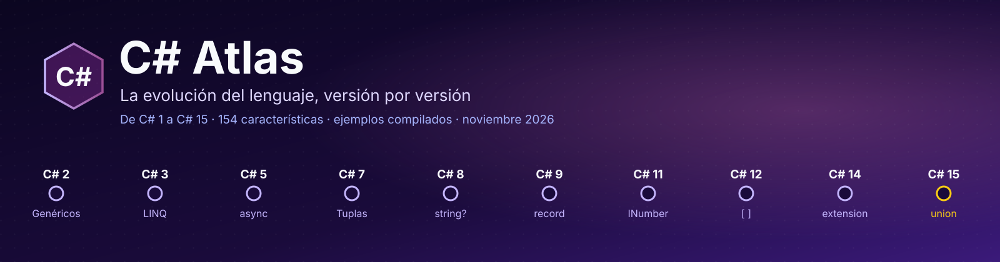
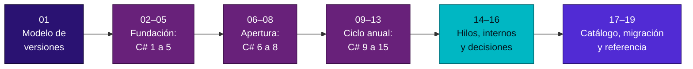
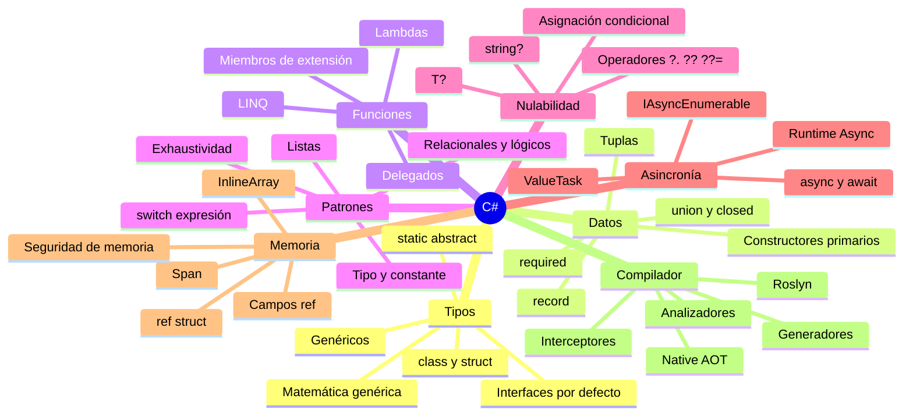
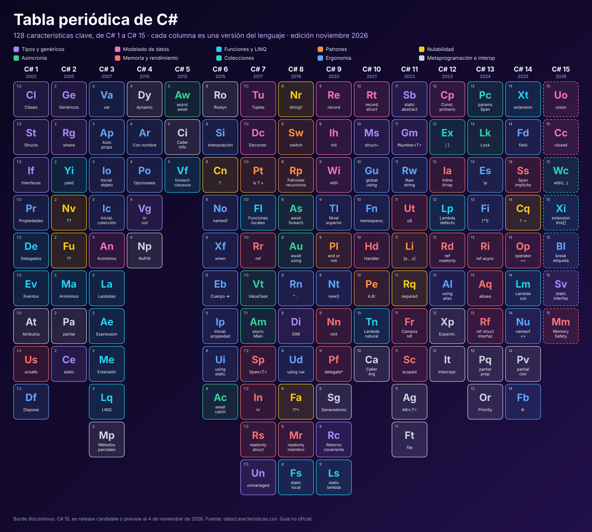
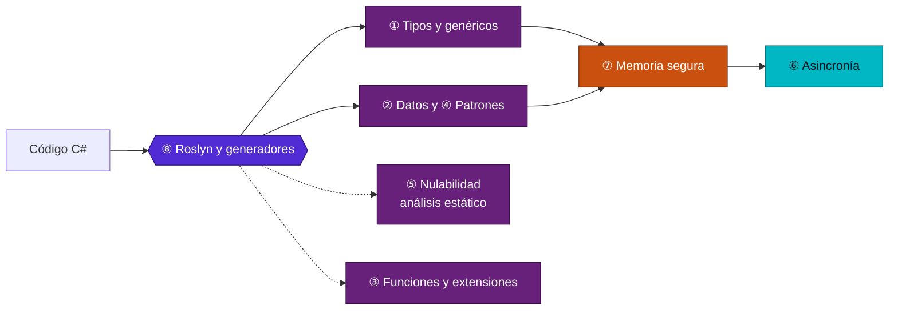

<p align="center">
  
</p>

<p align="center">
  
  
  
  
  
  
  
</p>

<p align="center">
  <b>C# Atlas</b> es una guía técnica en español sobre la <b>evolución del lenguaje C#</b>:<br>
  cada versión, de la 1.0 a la 15, con el problema que resolvía, su código antes y después, su semántica,<br>
  su costo, sus cambios incompatibles y el runtime y Visual Studio en que debutó, verificado al <b>4 de noviembre de 2026</b>.
</p>

---

## Contenido

- [¿Qué es C#?](#qué-es-c)
- [Estado actual del lenguaje](#estado-actual-del-lenguaje)
- [Cómo usar este atlas](#cómo-usar-este-atlas)
- [El universo C# en un mapa](#el-universo-c-en-un-mapa)
- [Tabla periódica de características](#tabla-periódica-de-características)
- [Índice de capítulos](#índice-de-capítulos)
- [Línea de tiempo: versión a versión](#línea-de-tiempo-versión-a-versión)
- [Antes y después en una línea](#antes-y-después-en-una-línea)
- [Las ocho grandes ideas](#las-ocho-grandes-ideas)
- [C# en cifras](#c-en-cifras)
- [Qué cambió en 2025–2026](#qué-cambió-en-20252026)
- [Plazos que no puedes ignorar](#plazos-que-no-puedes-ignorar)
- [Estructura del repositorio](#estructura-del-repositorio)
- [Convenciones](#convenciones)
- [Metodología y fuentes](#metodología-y-fuentes)

---

## ¿Qué es C#?

**C#** es un lenguaje de propósito general, con tipado estático y orientado a objetos y a componentes, creado en Microsoft por un equipo que dirigió Anders Hejlsberg y publicado
en 2002. Compila a un lenguaje intermedio que ejecuta el runtime de .NET, y está estandarizado como **ECMA-334** e **ISO/IEC 23270**. Su compilador, **Roslyn**, es de código abierto y el diseño del
lenguaje se discute en público en [`dotnet/csharplang`](https://github.com/dotnet/csharplang).

Lo que hace singular su historia es que **ha cambiado de paradigma sin romper a sus usuarios**: nació parecido a Java, incorporó programación declarativa con LINQ, popularizó `async`/`await`,
adoptó *pattern matching* y tipos de datos funcionales, y hoy compite en rendimiento con `Span<T>` y matemática genérica. El código de 2002 sigue compilando.

> [!IMPORTANT]
> **Este atlas se organiza por versiones del lenguaje, no por versiones de .NET.** C# 14 y .NET 10 están relacionados, pero son cosas distintas: consulta
> [01 · El modelo de versiones](docs/01-modelo-de-versiones.md).

---

## Estado actual del lenguaje

| | Versión | Runtime | Estado al 4-nov-2026 |
|---|---|---|---|
| 🟢 **Estable** | **C# 14** | .NET 10 LTS (soporte hasta el 14-nov-2028) | Recomendada para producción |
| 🟡 **Próxima** | **C# 15** | .NET 11, en RC3 con licencia *go-live* | Disponibilidad general prevista en noviembre de 2026 |
| 🟣 ***Preview*** | `LangVersion=preview` | SDK de .NET 11 | Modelo de seguridad de memoria: no apto para producción |

---

## Cómo usar este atlas

| Si eres… | Empieza por | Sigue con | Termina en |
|---|---|---|---|
| **Nuevo en C#** | [02 · C# 1](docs/02-csharp-1-cimientos.md) | [14 · Hilos evolutivos](docs/14-hilos-evolutivos.md) | [19 · Referencia](docs/19-referencia-rapida-y-glosario.md) |
| **Desarrollador/a con experiencia** | [12 · C# 14](docs/12-csharp-14-extensiones.md) y [13 · C# 15](docs/13-csharp-15-uniones.md) | [16 · Decisiones](docs/16-guias-de-decision.md) | [15 · Bajo el capó](docs/15-bajo-el-capo-y-rendimiento.md) |
| **Arquitecto/a** | [01 · Modelo de versiones](docs/01-modelo-de-versiones.md) | [16 · Decisiones](docs/16-guias-de-decision.md) | [18 · Migración](docs/18-migracion-y-ciclo-de-vida.md) |
| **Quien migra código antiguo** | [18 · Migración](docs/18-migracion-y-ciclo-de-vida.md) | Capítulo de cada versión que cruces | [17 · Catálogo](docs/17-catalogo-a-z.md) |
| **Interesado en rendimiento** | [15 · Bajo el capó](docs/15-bajo-el-capo-y-rendimiento.md) | [07 · `Span<T>`](docs/07-csharp-7-tuplas-patrones-y-ref.md#8-c-72-spant-y-la-familia-ref) | [10 · C# 11](docs/10-csharp-11-matematica-generica.md) |



---

## El universo C# en un mapa



---

## Tabla periódica de características

Las características más relevantes, una columna por versión del lenguaje y un color por familia. El catálogo completo tiene 154 entradas. Haz clic para ver el póster a tamaño completo.

<p align="center">
  <a href="assets/csharp-atlas-tabla-periodica.svg">
    
  </a>
</p>

> [!TIP]
> El póster y el [catálogo A–Z](docs/17-catalogo-a-z.md) se generan desde [`data/caracteristicas.csv`](data/caracteristicas.csv)
> con `python3 tools/generar_atlas.py`. Para actualizar una entrada, edita una fila y vuelve a ejecutar el script.

---

## Índice de capítulos

| # | Capítulo | Lo que encontrarás | Protagonistas |
|---|---|---|---|
| 01 | [**El modelo de versiones**](docs/01-modelo-de-versiones.md) | Lenguaje, compilador, biblioteca, runtime e IDE; tabla maestra; `LangVersion`; estandarización | `LangVersion`, TFM |
| 02 | [C# 1.0 y 1.2: los cimientos](docs/02-csharp-1-cimientos.md) | Sistema de tipos, *boxing*, propiedades, delegados, eventos, polimorfismo, atributos | `class`, `struct`, `event` |
| 03 | [C# 2.0: los genéricos](docs/03-csharp-2-genericos.md) | Reificación frente a borrado de tipos, restricciones, iteradores, `T?`, clausuras | `List<T>`, `yield` |
| 04 | [C# 3.0: LINQ](docs/04-csharp-3-linq.md) | Lambdas, extensiones, consultas, ejecución diferida, árboles de expresión | LINQ, `var` |
| 05 | [C# 4.0 y 5.0: dinamismo y asincronía](docs/05-csharp-4-5-dinamismo-y-asincronia.md) | `dynamic`, varianza, máquina de estados, reglas de producción, cambio en `foreach` | `async`, `await` |
| 06 | [C# 6.0: Roslyn](docs/06-csharp-6-roslyn.md) | El compilador como plataforma, `?.`, interpolación, `nameof`, filtros de excepción | Roslyn, `?.` |
| 07 | [C# 7.0–7.3: tuplas, patrones y `ref`](docs/07-csharp-7-tuplas-patrones-y-ref.md) | Tuplas, deconstrucción, funciones locales, `Span<T>`, copia defensiva | `Span<T>`, `in` |
| 08 | [C# 8.0: nulabilidad y flujos asíncronos](docs/08-csharp-8-nulabilidad-y-streams.md) | `string?`, patrones recursivos, `IAsyncEnumerable<T>`, rangos, interfaces por defecto | `string?`, `switch` |
| 09 | [C# 9 y 10: `record`](docs/09-csharp-9-10-records.md) | `record`, `init`, patrones lógicos, generadores, `global using`, manejadores de interpolación | `record`, `with` |
| 10 | [C# 11: matemática genérica](docs/10-csharp-11-matematica-generica.md) | `static abstract`, `INumber<T>`, cadenas sin formato, patrones de lista, campos `ref` | `INumber<T>`, `required` |
| 11 | [C# 12 y 13: colecciones](docs/11-csharp-12-13-colecciones.md) | Constructores primarios, `[…]`, interceptores, `params` de colección, `Lock`, `allows ref struct` | `[…]`, `Lock` |
| 12 | [**C# 14: miembros de extensión**](docs/12-csharp-14-extensiones.md) | `extension`, `field`, `Span` implícito, `?.=`, `operator +=`, aplicaciones de un archivo | `extension`, `field` |
| 13 | [**C# 15: uniones**](docs/13-csharp-15-uniones.md) | `union`, `closed`, `with(...)`, saltos con etiqueta, seguridad de memoria, lo que viene | `union`, `closed` |
| 14 | [Hilos evolutivos](docs/14-hilos-evolutivos.md) | Un mismo programa en cinco épocas; patrones, datos, memoria y más, a través del tiempo | — |
| 15 | [Bajo el capó y rendimiento](docs/15-bajo-el-capo-y-rendimiento.md) | Traducción del compilador, mapa de costos, seguridad de referencias, Native AOT, caso real | — |
| 16 | [Guías de decisión](docs/16-guias-de-decision.md) | Árboles para datos, uniones, errores, colecciones, concurrencia, versión y TFM | — |
| 17 | [Catálogo A–Z](docs/17-catalogo-a-z.md) | 154 características con versión, familia, requisito y estado | Todas |
| 18 | [Migración y ciclo de vida](docs/18-migracion-y-ciclo-de-vida.md) | Soporte de .NET, método de migración, cambios incompatibles versión por versión | — |
| 19 | [Referencia rápida y glosario](docs/19-referencia-rapida-y-glosario.md) | CLI, varios puntos de entrada, operadores, código del repositorio y glosario | — |

---

## Línea de tiempo: versión a versión

| C# | Fecha | Visual Studio | Runtime de debut | Características clave | Laboratorio |
|---|---|---|---|---|---|
| [**1.0**](docs/02-csharp-1-cimientos.md) | ene-2002 | VS .NET 2002 | .NET Framework 1.0 | Clases, `struct`, interfaces, propiedades, delegados, eventos, atributos | [CSharp1](https://github.com/CristianSifuentes/CSharp1) |
| [**1.2**](docs/02-csharp-1-cimientos.md#8-c-12-dispose-en-foreach) | abr-2003 | VS .NET 2003 | .NET Framework 1.1 | `Dispose` en `foreach` | — |
| [**2.0**](docs/03-csharp-2-genericos.md) | nov-2005 | VS 2005 | .NET Framework 2.0 | Genéricos, iteradores, `T?`, métodos anónimos, `partial` | [CSharp2](https://github.com/CristianSifuentes/CSharp2) |
| [**3.0**](docs/04-csharp-3-linq.md) | nov-2007 | VS 2008 | .NET Framework 3.5 | LINQ, lambdas, extensiones, `var`, tipos anónimos | [CSharp3](https://github.com/CristianSifuentes/CSharp3) |
| [**4.0**](docs/05-csharp-4-5-dinamismo-y-asincronia.md) | abr-2010 | VS 2010 | .NET Framework 4.0 | `dynamic`, argumentos con nombre, varianza genérica | [CSharp4](https://github.com/CristianSifuentes/CSharp4) |
| [**5.0**](docs/05-csharp-4-5-dinamismo-y-asincronia.md#5-c-5-el-problema-de-la-asincronía) | ago-2012 | VS 2012 | .NET Framework 4.5 | `async`/`await`, información del llamador | [CSharp5](https://github.com/CristianSifuentes/CSharp5) |
| [**6.0**](docs/06-csharp-6-roslyn.md) | jul-2015 | VS 2015 | .NET Framework 4.6 | Roslyn, `?.`, interpolación, `nameof`, filtros | [CSharp6](https://github.com/CristianSifuentes/CSharp6) |
| [**7.0–7.3**](docs/07-csharp-7-tuplas-patrones-y-ref.md) | 2017–2018 | VS 2017 | .NET Framework 4.7 · .NET Core 2.x | Tuplas, patrones, `Span<T>`, `in`, `ref struct`, `async Main` | [CSharp7](https://github.com/CristianSifuentes/CSharp7) |
| [**8.0**](docs/08-csharp-8-nulabilidad-y-streams.md) | sep-2019 | VS 2019 16.3 | .NET Core 3.0 | `string?`, `switch` expresión, flujos asíncronos, rangos | [CSharp8](https://github.com/CristianSifuentes/CSharp8) |
| [**9**](docs/09-csharp-9-10-records.md) | nov-2020 | VS 2019 16.8 | .NET 5 | `record`, `init`, nivel superior, patrones lógicos | [CSharp9](https://github.com/CristianSifuentes/CSharp9) |
| [**10**](docs/09-csharp-9-10-records.md#7-c-10-organización-del-código) | nov-2021 | VS 2022 17.0 | .NET 6 | `record struct`, `global using`, `namespace X;`, manejadores | [CSharp10](https://github.com/CristianSifuentes/CSharp10) |
| [**11**](docs/10-csharp-11-matematica-generica.md) | nov-2022 | VS 2022 17.4 | .NET 7 | `INumber<T>`, `"""`, patrones de lista, `required`, campos `ref` | [CSharp11](https://github.com/CristianSifuentes/CSharp11) |
| [**12**](docs/11-csharp-12-13-colecciones.md) | nov-2023 | VS 2022 17.8 | .NET 8 | Constructores primarios, `[…]`, `InlineArray`, alias | [CSharp12](https://github.com/CristianSifuentes/CSharp12) |
| [**13**](docs/11-csharp-12-13-colecciones.md#6-c-13-colecciones-params) | nov-2024 | VS 2022 17.12 | .NET 9 | `params` de colección, `Lock`, `allows ref struct` | [CSharp13](https://github.com/CristianSifuentes/CSharp13) |
| [**14** 🟢](docs/12-csharp-14-extensiones.md) | nov-2025 | VS 2026 18.0 | .NET 10 | `extension`, `field`, `Span` implícito, `?.=`, `+=` definido | [CSharp14](https://github.com/CristianSifuentes/CSharp14) |
| [**15** 🟡](docs/13-csharp-15-uniones.md) | RC, nov-2026 | VS 2026 18.8+ | .NET 11 | `union`, `closed`, `with(...)`, `break` con etiqueta | [CSharp15](https://github.com/CristianSifuentes/CSharp15) |

---

## Antes y después en una línea

El mismo pensamiento, en dos épocas. Son formas resumidas y no se compilan por separado: los ejemplos completos y verificados están en cada capítulo y en [14 · Hilos evolutivos](docs/14-hilos-evolutivos.md).

| Versión | Antes | Después |
|---|---|---|
| **C# 2** | `int n = (int)lista[0];` | `int n = lista[0];` |
| **C# 3** | `delegate(int x) { return x > 1; }` | `x => x > 1` |
| **C# 5** | `t.ContinueWith(r => Usar(r.Result));` | `Usar(await t);` |
| **C# 6** | `string.Format("{0}", x)` | `$"{x}"` |
| **C# 6** | `if (a != null) a.Invoke();` | `a?.Invoke();` |
| **C# 7** | `int n; int.TryParse(s, out n);` | `int.TryParse(s, out int n);` |
| **C# 8** | `if (x == null) x = new();` | `x ??= new();` |
| **C# 9** | `List<int> a = new List<int>();` | `List<int> a = new();` |
| **C# 10** | `namespace A { … }` | `namespace A;` |
| **C# 11** | `"{\"a\": 1}"` | `"""{"a": 1}"""` |
| **C# 12** | `new List<int> { 1, 2 }` | `[1, 2]` |
| **C# 14** | `if (c != null) c.Total = 1;` | `c?.Total = 1;` |
| **C# 15** | `interface I { }` + `_ => throw` | `union U(A, B);` |

```csharp cs=15 run
// C# 15 en una mirada: datos, patrones y colecciones trabajando juntos
List<Evento> eventos = [new Alta("Ana"), new Baja("Luis", "impago"), new Alta("Eva")];

foreach (var e in eventos)
{
    Console.WriteLine(e switch
    {
        Alta(var nombre) => $"+ {nombre}",
        Baja(var nombre, var motivo) => $"- {nombre} ({motivo})",
        null => "?",
    });
    // → + Ana
    // → - Luis (impago)
    // → + Eva
}

record Alta(string Nombre);
record Baja(string Nombre, string Motivo);
union Evento(Alta, Baja);
```

---

## Las ocho grandes ideas

> C# no avanza por versiones aisladas, sino por **hilos** que se extienden durante años. Un `union` de 2026 es el último eslabón de una cadena iniciada con las tuplas de 2017.

| Hilo | De dónde viene | A dónde ha llegado | Matiz de experto |
|---|---|---|---|
| **① Tipos** | Genéricos reificados (C# 2) | `static abstract` e `INumber<T>` (C# 11) | El JIT especializa por tipo de valor: la abstracción no cuesta en ejecución |
| **② Datos** | `class` y tipos anónimos | `record` y `union` | `with` es copia superficial, y un `record` compara arreglos por referencia |
| **③ Funciones** | Delegados (C# 1) | Miembros de extensión (C# 14) | Una clausura asigna; `static` lo convierte en error visible |
| **④ Patrones** | `is T x` (C# 7) | Exhaustividad sobre uniones (C# 15) | `not` tiene más prioridad que `or` |
| **⑤ Nulabilidad** | `int?` (C# 2) | `string?` y `?.=` | Es análisis estático: `string?` no existe en ejecución |
| **⑥ Asincronía** | `BeginX`/`EndX` | `IAsyncEnumerable<T>` y Runtime Async | `await` no crea hilos |
| **⑦ Memoria** | `unsafe` (C# 1) | `Span<T>` y seguridad de memoria | Un `struct` no `readonly` pasado como `in` genera copias ocultas |
| **⑧ Generación** | `partial` (C# 2) | Generadores e interceptores | Son la base práctica de Native AOT |



---

## C# en cifras

| Indicador (nov-2026) | Valor |
|---|---|
| Años desde C# 1.0 | **24** |
| Versiones con número propio | **19** (de 1.0 a 15, incluidas 1.2 y 7.1–7.3) |
| Versiones publicadas cada noviembre | **6** seguidas: de C# 9 a C# 14, con C# 15 a punto |
| Características en este catálogo | **154** |
| Ediciones de ECMA-334 | **7**; la última es de diciembre de 2023 |
| Versión por defecto en .NET Framework | **C# 7.3** |
| Runtimes de .NET con soporte hoy | **3** (.NET 8, 9 y 10), y solo **.NET 10** tras el 10-nov-2026 hasta la GA de .NET 11 |

---

## Qué cambió en 2025–2026

| Área | Novedad | Versión | Estado |
|---|---|---|---|
| Extensiones | Bloques `extension`: propiedades, estáticos y operadores | C# 14 | 🟢 |
| Propiedades | `field`: fin del campo manual en propiedades con lógica | C# 14 | 🟢 |
| Rendimiento | `Span<T>` de primera clase; `operator +=` en el sitio | C# 14 | 🟢 |
| Nulabilidad | `a?.b = c` | C# 14 | 🟢 |
| Herramientas | `dotnet run app.cs`, sin proyecto y con Native AOT al publicar | SDK 10 | 🟢 |
| Tipos | **`union`**: tipos suma nativos | C# 15 | 🟡 |
| Tipos | **`closed`**: jerarquías cerradas y exhaustivas | C# 15 | 🟡 |
| Colecciones | `[with(capacity: n), …]` | C# 15 | 🟡 |
| Extensiones | Indexadores de extensión | C# 15 | 🟡 |
| Control de flujo | `break` y `continue` con etiqueta | C# 15 | 🟡 |
| Runtime | **Runtime Async**: asincronía en el runtime, sin cambiar la sintaxis | .NET 11 | 🟡 |
| JSON | `System.Text.Json` entiende uniones | .NET 11 | 🟡 |
| Memoria | Nuevo modelo de `unsafe` | `preview` | 🟣 |

---

## Plazos que no puedes ignorar

| Fecha | Qué ocurre | Acción |
|---|---|---|
| **10-nov-2026** | Fin de soporte de **.NET 8** (C# 12) y **.NET 9** (C# 13) · fin del RC3 de .NET 11 | Migrar a **.NET 10 LTS** |
| **nov-2026** | Disponibilidad general prevista de **.NET 11** y **C# 15** | Evaluar; STS con dos años de soporte |
| **14-nov-2028** | Fin de soporte de **.NET 10** (C# 14) | Planificar el salto al siguiente LTS |

> [!WARNING]
> Una versión de C# no caduca, pero **su runtime sí**. Lista completa de cambios incompatibles y método de migración: [18 · Migración y ciclo de vida](docs/18-migracion-y-ciclo-de-vida.md).

---

## Estructura del repositorio

```text
.
├── README.md                     ← estás aquí (portada e índice)
├── docs/                         ← 19 capítulos
│   ├── 01-modelo-de-versiones.md
│   ├── 02 … 13                   ← un capítulo por versión o par de versiones
│   ├── 14-hilos-evolutivos.md
│   ├── 15-bajo-el-capo-y-rendimiento.md
│   ├── 16-guias-de-decision.md
│   ├── 17-catalogo-a-z.md        ← generado desde data/caracteristicas.csv
│   ├── 18-migracion-y-ciclo-de-vida.md
│   └── 19-referencia-rapida-y-glosario.md
├── data/caracteristicas.csv      ← fuente única del catálogo y del póster
├── tools/
│   ├── generar_atlas.py          ← regenera catálogo, póster y banner (Python 3, sin dependencias)
│   └── verificar_ejemplos.py     ← compila cada ejemplo con su versión exacta de C#
├── assets/                       ← banner y tabla periódica en SVG
├── *.cs, Matrix.Test/            ← caso práctico: multiplicación concurrente de matrices
└── LICENSE                       ← Apache 2.0
```

```bash
# Regenerar catálogo A–Z, póster y banner después de editar data/caracteristicas.csv
python3 tools/generar_atlas.py

# Compilar y ejecutar todos los ejemplos (requiere el SDK de .NET 11 o posterior)
python3 tools/verificar_ejemplos.py --dotnet /ruta/a/dotnet
```

---

## Convenciones

| Símbolo | Significado |
|---|---|
| 🟢 | Estable |
| 🟡 | *Release candidate* |
| 🟣 | *Preview* |
| 🟠 | Soporte a punto de terminar |
| ⛔ | Sin soporte |
| ⚠️ | Cambio de comportamiento sin error de compilación |
| `// → texto` | Salida real del programa, comprobada al ejecutarlo |
| Recuadros *Note*, *Tip*, *Important*, *Warning*, *Caution* | Notas, consejos, puntos clave, advertencias y precauciones |

Colores de los diagramas: **morado** = lenguaje · **índigo** = compilador y herramientas · **turquesa** = runtime · **naranja** = datos y patrones.

---

## Metodología y fuentes

- **Fecha de corte:** 4 de noviembre de 2026. C# 14 es la última versión estable; C# 15 se documenta tal como está en .NET 11 RC3. Las novedades posteriores, incluida la GA de .NET 11, no están incluidas.
- **Ejemplos verificados:** 140 de los 143 bloques ```` ```csharp ```` se compilaron con el SDK `11.0.100-rc.3.26522.148` y **con el `-langversion` de su época**: un ejemplo de C# 7.3 demuestra que solo usa sintaxis de C# 7.3. De ellos, 104 se ejecutan y su salida se compara
  con los comentarios `// →`, y 13 deben fallar con el código exacto que documentan. Los 3 restantes son formas ilustrativas o requieren paquetes externos. Un compilador moderno no reproduce cada particularidad de los compiladores históricos, y los fragmentos dentro de tablas no se verifican.
- **Fuentes:** Microsoft Learn (*What's new*, *The history of C#*, *Language versioning*, referencia del lenguaje), listas de *breaking changes* de Roslyn, `Language-Version-History.md` de `dotnet/csharplang`, *Language Feature Status* de Roslyn, política de soporte de .NET y
  el estándar ECMA-334. Algunas semánticas de C# 15 se comprobaron por reflexión sobre el RC3.
- **Límites:** la columna "runtime de debut" es orientativa, sobre todo en C# 7.x. Los detalles de C# 15 y de *preview* pueden cambiar. Este atlas no es documentación oficial de Microsoft.
- **Correcciones respecto a versiones anteriores de este README:** este atlas sustituye al README en inglés. Su contenido se conserva y se amplía, se corrigieron ejemplos que no compilaban y varias características se
  reasignaron a su versión real. Las correcciones de C# 13 y C# 14 ya se habían hecho en mayo de 2026.
- **Contribuir:** abre un *issue* o *pull request*. Para el catálogo, edita `data/caracteristicas.csv` y ejecuta el generador; para los ejemplos, ejecuta el verificador.

---

<p align="center">
  Hecho con 💜 para la comunidad hispanohablante · Licencia <a href="LICENSE">Apache 2.0</a> ·
  <a href="https://learn.microsoft.com/dotnet/csharp/">learn.microsoft.com/dotnet/csharp</a>
</p>
