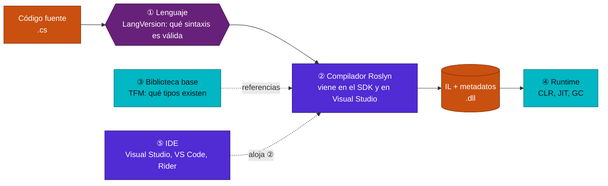
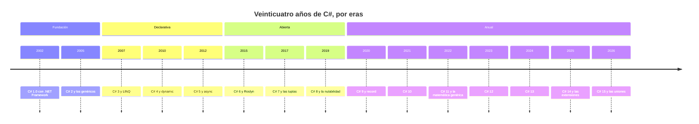
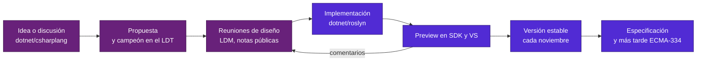

<div align="center">

# 01 · El modelo de versiones de C#

**Lenguaje, compilador, runtime, biblioteca e IDE: cinco relojes que no marcan la misma hora**

[🏠 Índice](../README.md) · [02 · C# 1 ➡](02-csharp-1-cimientos.md)

</div>

> [!IMPORTANT]
> Este atlas toma como eje la **versión del lenguaje**. "C# 14" y ".NET 10" no son sinónimos: uno define qué
> sintaxis acepta el compilador y el otro qué tipos y qué comportamiento encuentra tu programa al ejecutarse.
> Confundirlos es el origen de buena parte de los errores de migración.

---

## Contenido

1. [Los cinco relojes](#1-los-cinco-relojes)
2. [Tabla maestra de versiones](#2-tabla-maestra-de-versiones)
3. [Qué necesita cada característica](#3-qué-necesita-cada-característica)
4. [Cómo se elige la versión del lenguaje](#4-cómo-se-elige-la-versión-del-lenguaje)
5. [Cadencia: de los grandes saltos al ciclo anual](#5-cadencia-de-los-grandes-saltos-al-ciclo-anual)
6. [La estandarización: ECMA-334 e ISO/IEC 23270](#6-la-estandarización-ecma-334-e-isoiec-23270)
7. [Cómo nace una característica](#7-cómo-nace-una-característica)
8. [Referencias](#8-referencias)

---

## 1. Los cinco relojes



| Reloj | Qué versiona | Dónde se fija | Ejemplo |
|---|---|---|---|
| **① Lenguaje** | Gramática y reglas semánticas | `<LangVersion>` o, por defecto, el TFM | C# 14 |
| **② Compilador** | La implementación (Roslyn) | Versión del SDK o de Visual Studio | SDK 10.0.103 |
| **③ Biblioteca base** | Los tipos que el código puede usar | `<TargetFramework>` | `net10.0` |
| **④ Runtime** | Ejecución real: JIT, GC, carga de tipos | Lo instalado en la máquina o publicado con la app | .NET 10.0.14 |
| **⑤ IDE** | La experiencia de edición | Visual Studio 2026, VS Code + C# Dev Kit, Rider | VS 2026 18.11 |

Una consecuencia práctica: **un SDK nuevo compila código antiguo**. El compilador de .NET 11 acepta
`-langversion:1`, y este atlas aprovecha ese hecho para compilar cada ejemplo con su versión histórica.

---

## 2. Tabla maestra de versiones

Estado: 🟢 estable · **Runtime de debut** indica con qué plataforma se publicó la versión, no el
único runtime posible.

| C# | Publicación | Visual Studio | Runtime de debut | `LangVersion` | Tema dominante | Capítulo |
|---|---|---|---|---|---|---|
| **1.0** | ene-2002 | VS .NET 2002 | .NET Framework 1.0 | `1` / `ISO-1` | Orientación a objetos administrada | [02](02-csharp-1-cimientos.md) |
| **1.2** | abr-2003 | VS .NET 2003 | .NET Framework 1.1 | `1` / `ISO-1` | `Dispose` en `foreach` | [02](02-csharp-1-cimientos.md) |
| **2.0** | nov-2005 | VS 2005 | .NET Framework 2.0 | `2` / `ISO-2` | Genéricos | [03](03-csharp-2-genericos.md) |
| **3.0** | nov-2007 | VS 2008 | .NET Framework 3.5 | `3` | LINQ | [04](04-csharp-3-linq.md) |
| **4.0** | abr-2010 | VS 2010 | .NET Framework 4.0 | `4` | Dinamismo e interoperabilidad | [05](05-csharp-4-5-dinamismo-y-asincronia.md) |
| **5.0** | ago-2012 | VS 2012 | .NET Framework 4.5 | `5` | `async` / `await` | [05](05-csharp-4-5-dinamismo-y-asincronia.md) |
| **6.0** | jul-2015 | VS 2015 | .NET Framework 4.6 | `6` | Roslyn y menos ceremonia | [06](06-csharp-6-roslyn.md) |
| **7.0** | mar-2017 | VS 2017 | .NET Framework 4.7 · .NET Core 1.x | `7` | Tuplas y patrones | [07](07-csharp-7-tuplas-patrones-y-ref.md) |
| **7.1** | ago-2017 | VS 2017 15.3 | .NET Core 2.0 | `7.1` | `async Main` | [07](07-csharp-7-tuplas-patrones-y-ref.md) |
| **7.2** | nov-2017 | VS 2017 15.5 | .NET Core 2.0 | `7.2` | `Span<T>` y `ref struct` | [07](07-csharp-7-tuplas-patrones-y-ref.md) |
| **7.3** | may-2018 | VS 2017 15.7 | .NET Core 2.1 | `7.3` | Código seguro y rápido | [07](07-csharp-7-tuplas-patrones-y-ref.md) |
| **8.0** | sep-2019 | VS 2019 16.3 | .NET Core 3.0 | `8.0` | Nulabilidad y flujos asíncronos | [08](08-csharp-8-nulabilidad-y-streams.md) |
| **9** | nov-2020 | VS 2019 16.8 | .NET 5 | `9.0` | `record` | [09](09-csharp-9-10-records.md) |
| **10** | nov-2021 | VS 2022 17.0 | .NET 6 | `10.0` | Menos ceremonia a escala | [09](09-csharp-9-10-records.md) |
| **11** | nov-2022 | VS 2022 17.4 | .NET 7 | `11.0` | Matemática genérica | [10](10-csharp-11-matematica-generica.md) |
| **12** | nov-2023 | VS 2022 17.8 | .NET 8 | `12.0` | Expresiones de colección | [11](11-csharp-12-13-colecciones.md) |
| **13** | nov-2024 | VS 2022 17.12 | .NET 9 | `13.0` | `params` de colección y `ref struct` | [11](11-csharp-12-13-colecciones.md) |
| **14** | nov-2025 | VS 2026 18.0 | .NET 10 | `14.0` | Miembros de extensión | [12](12-csharp-14-extensiones.md) |
| **15** 🟢 | nov-2026 | VS 2026 18.8+ | .NET 11 | `15.0` | Uniones y jerarquías cerradas | [13](13-csharp-15-uniones.md) |



---

## 3. Qué necesita cada característica

No todas las características cuestan lo mismo de adoptar. Conviene clasificarlas por **lo que exigen por debajo del
compilador**.

| Clase | Qué exige | Ejemplos | ¿Se puede usar en un TFM antiguo? |
|---|---|---|---|
| **Solo compilador** | Nada: se traduce a IL ya existente | `var`, lambdas, `?.`, interpolación, *pattern matching*, tipos de referencia anulables, `field` | Normalmente sí, aunque es una configuración sin soporte oficial |
| **Biblioteca** | Tipos concretos | `async` (`Task`), tuplas (`ValueTuple`), rangos (`Index`, `Range`), `init` (`IsExternalInit`), `required`, uniones (`UnionAttribute`, `IUnion`) | A veces, con paquetes o *polyfills* |
| **Runtime** | Cambios en el CLR | Genéricos (C# 2), métodos de interfaz por defecto (C# 8), miembros `static abstract` (C# 11), campos `ref` (C# 11), `allows ref struct` (C# 13) | **No** |

> [!CAUTION]
> Microsoft indica que usar una versión del lenguaje **más nueva que la asociada al TFM no está soportado**. Puede
> compilar y romper al ejecutar, o escoger otra sobrecarga. El caso de `Enumerable.Reverse` con C# 14 sobre un TFM
> anterior a `net10.0` se detalla en [18 § C# 14](18-migracion-y-ciclo-de-vida.md#c-14).

---

## 4. Cómo se elige la versión del lenguaje

### 4.1 Valores por defecto

Si no escribes `<LangVersion>`, el compilador la deduce del TFM:

| Destino | Versión | C# por defecto |
|---|---|---|
| .NET | 11.x | C# 15 |
| .NET | 10.x | C# 14 |
| .NET | 9.x | C# 13 |
| .NET | 8.x | C# 12 |
| .NET | 7.x | C# 11 |
| .NET | 6.x | C# 10 |
| .NET | 5.x | C# 9 |
| .NET Core | 3.x | C# 8 |
| .NET Core | 2.x | C# 7.3 |
| .NET Standard | 2.1 | C# 8 |
| .NET Standard | 2.0 y 1.x | C# 7.3 |
| .NET Framework | todas | C# 7.3 |

### 4.2 Valores de `LangVersion`

| Valor | Significado | Recomendación |
|---|---|---|
| *(omitido)* | Lo deduce del TFM | ✅ La opción por defecto |
| `14.0`, `13.0`… | Fija una versión | ✅ Cuando quieres un límite explícito |
| `preview` | Última sintaxis en *preview* | ⚠️ Solo para experimentar |
| `latest` | Última versión del compilador instalado, incluidas menores | ❌ Depende de la máquina |
| `latestMajor`, `default` | Última versión mayor del compilador | ❌ Ignora el TFM |

> [!WARNING]
> **`default` no equivale a omitir la propiedad**: `default` usa la versión más reciente del compilador sin mirar el
> TFM. Y Microsoft desaconseja `latest` porque su valor cambia de una máquina a otra. Este repositorio lo usa en
> [`C-sharp.csproj`](../C-sharp.csproj); con `net10.0`, omitirlo daría C# 14 de forma reproducible.

### 4.3 Recetas

```xml
<!-- Directory.Build.props en la raíz: una sola versión para toda la solución -->
<Project>
  <PropertyGroup>
    <LangVersion>14.0</LangVersion>
    <Nullable>enable</Nullable>
    <TreatWarningsAsErrors>true</TreatWarningsAsErrors>
  </PropertyGroup>
</Project>
```

```json
{
  "sdk": { "version": "10.0.100", "rollForward": "latestFeature" }
}
```

El segundo bloque es un `global.json`: fija el SDK, y con él el compilador, para que todo el equipo y la integración
continua produzcan el mismo resultado.

Para saber qué versión está activa, añade esta directiva y compila. El error CS8304 informa del compilador y del
lenguaje seleccionado:

```csharp err=CS8304
#error version
```

---

## 5. Cadencia: de los grandes saltos al ciclo anual

| Era | Años | Ritmo | Entrega ligada a | Consecuencia |
|---|---|---|---|---|
| Fundación y declarativa | 2002–2012 | 2 a 3 años | Visual Studio y .NET Framework | Pocas versiones con cambios de paradigma |
| Abierta | 2015–2019 | Irregular, con versiones menores 7.1–7.3 | Roslyn y .NET Core | Se introduce la selección de versión del lenguaje |
| Anual | 2020–hoy | **Cada noviembre** | .NET | Las características grandes se entregan por fases y en *preview* |

El ciclo anual cambia cómo debe leerse una versión. Las grandes ideas ya no llegan de una vez: el modelado de datos se
extendió desde las tuplas de C# 7 hasta las uniones de C# 15, y la seguridad de memoria avanza desde `Span<T>` en 7.2 hasta
la *preview* de C# 15. El [capítulo 14](14-hilos-evolutivos.md) sigue esos hilos a través de las versiones.

---

## 6. La estandarización: ECMA-334 e ISO/IEC 23270

| Edición de ECMA-334 | Fecha | Etiqueta |
|---|---|---|
| 1.ª | dic-2001 | — |
| 2.ª | dic-2002 | — |
| 3.ª | jun-2005 | — |
| 4.ª | jun-2006 | — |
| 5.ª | dic-2017 | ECMA-334:2017 (V5) |
| 6.ª | jun-2022 | ECMA-334:2022 (V6) |
| 7.ª | dic-2023 | ECMA-334:2023 (V7) |

Dos ideas para no confundirse:

- **El estándar va varios años detrás de la implementación.** La referencia del día a día son las especificaciones de
  características publicadas en Microsoft Learn y en `dotnet/csharplang`.
- Los valores `ISO-1` e `ISO-2` de `LangVersion` corresponden a ISO/IEC 23270:2003 (C# 1.0/1.2) e ISO/IEC 23270:2006
  (C# 2.0).

---

## 7. Cómo nace una característica



Una propuesta puede cambiar mucho antes de publicarse, o no llegar nunca. Por eso este atlas **no documenta rumores**:
el estado de lo que está en camino se resume en [13 § Lo que viene](13-csharp-15-uniones.md#10-lo-que-viene) y procede de la
página *Language Feature Status* de Roslyn.

---

## 8. Referencias

- [Language versioning](https://learn.microsoft.com/dotnet/csharp/language-reference/language-versioning) · [Configure language version](https://learn.microsoft.com/dotnet/csharp/language-reference/configure-language-version)
- [The history of C#](https://learn.microsoft.com/dotnet/csharp/whats-new/csharp-version-history) · [Language-Version-History.md](https://github.com/dotnet/csharplang/blob/main/Language-Version-History.md)
- [Relationships between language and library](https://learn.microsoft.com/dotnet/csharp/whats-new/relationships-between-language-and-library)
- [Standard ECMA-334](https://ecma-international.org/publications-and-standards/standards/ecma-334/) · [Language Feature Status](https://github.com/dotnet/roslyn/blob/main/docs/Language%20Feature%20Status.md)
