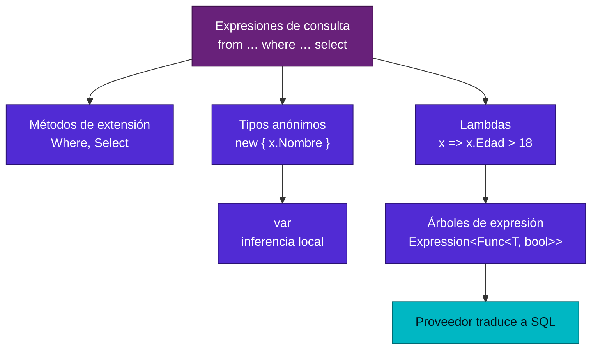

<div align="center">

# 04 · C# 3.0: LINQ

**Lambdas, extensiones, inferencia, tipos anónimos y árboles de expresión: el giro declarativo (2007)**

[⬅ 03 · C# 2](03-csharp-2-genericos.md) · [🏠 Índice](../README.md) · [05 · C# 4 y 5 ➡](05-csharp-4-5-dinamismo-y-asincronia.md)

</div>

<!-- cs=3 -->

| Ficha | C# 3.0 |
|---|---|
| **Publicación** | noviembre de 2007 |
| **Visual Studio** | VS 2008 |
| **Runtime** | .NET Framework 3.5 (sobre CLR 2.0) |
| **`LangVersion` actual** | `3` |
| **Clase de cambio** | **Solo compilador y biblioteca**: no hubo cambios en el CLR |
| **Laboratorio** | [CristianSifuentes/CSharp3](https://github.com/CristianSifuentes/CSharp3) |

> [!NOTE]
> La documentación antigua de este repositorio asociaba C# 3 con .NET Framework 3.0. La biblioteca que hace posible LINQ,
> `System.Core`, llegó con **.NET Framework 3.5**.

---

## Contenido

1. [Una versión, una sola idea](#1-una-versión-una-sola-idea)
2. [Inferencia e inicializadores](#2-inferencia-e-inicializadores)
3. [Lambdas](#3-lambdas)
4. [Métodos de extensión](#4-métodos-de-extensión)
5. [Expresiones de consulta](#5-expresiones-de-consulta)
6. [Ejecución diferida](#6-ejecución-diferida)
7. [Árboles de expresión: `Func` frente a `Expression<Func>`](#7-árboles-de-expresión-func-frente-a-expressionfunc)
8. [Rendimiento y buenas prácticas](#8-rendimiento-y-buenas-prácticas)
9. [Notas de migración](#9-notas-de-migración)
10. [Referencias](#10-referencias)

---

## 1. Una versión, una sola idea

Casi cada característica de C# 3 es una pieza de **LINQ**. Se pueden usar por separado, pero fueron diseñadas para encajar.



---

## 2. Inferencia e inicializadores

```csharp cs=2 cuerpo
// Antes (C# 2)
Dictionary<string, List<int>> mapa = new Dictionary<string, List<int>>();
List<int> numeros = new List<int>();
numeros.Add(1);
numeros.Add(2);
mapa.Add("a", numeros);
```

```csharp cuerpo
// Después (C# 3)
var mapa = new Dictionary<string, List<int>>
{
    { "a", new List<int> { 1, 2 } }
};
```

| Característica | Se traduce a | Precisión importante |
|---|---|---|
| **`var`** | El tipo inferido en compilación | **No es `dynamic`**: sigue siendo tipado estático |
| **Propiedad automática** | Campo oculto + `get`/`set` | Base de `init`, `required` y `field` |
| **Inicializador de objeto** | `new` + asignaciones | Una variable temporal evita observar el objeto a medio construir |
| **Inicializador de colección** | `new` + llamadas a `Add` | Requiere `IEnumerable` y `Add`; precursor de `[1, 2]` en C# 12 |
| **Tipo anónimo** | Clase `internal` inmutable generada | `Equals` y `GetHashCode` por valor: ¡un `record` en germen! |

```csharp run
class Programa
{
    static void Main()
    {
        var a = new { Nombre = "Ana", Edad = 30 };
        var b = new { Nombre = "Ana", Edad = 30 };
        Console.WriteLine(a.Equals(b));               // → True
        Console.WriteLine(a.GetType() == b.GetType()); // → True
        Console.WriteLine(a);                         // → { Nombre = Ana, Edad = 30 }
    }
}
```

---

## 3. Lambdas

| Versión | Sintaxis |
|---|---|
| C# 1 | `new Predicate<int>(EsPar)` y un método con nombre |
| C# 2 | `delegate(int n) { return n % 2 == 0; }` |
| C# 3 | `n => n % 2 == 0` |
| C# 9 | `static n => n % 2 == 0` y parámetros `_` |
| C# 10 | Tipo natural y atributos: `var f = (int n) => n % 2 == 0;` |
| C# 12 | Valores por defecto: `(int n = 0) => n` |
| C# 14 | Modificadores sin tipos: `(texto, out resultado) => …` |

La familia `Func<>` y `Action<>` llegó con .NET 3.5 y evitó declarar delegados propios para casi todo.

---

## 4. Métodos de extensión

```csharp run
static class TextoExtensiones
{
    public static string Iniciales(this string texto)
    {
        return string.Concat(texto.Split(' ').Select(p => p[0]));
    }
}

class Programa
{
    static void Main()
    {
        Console.WriteLine("Ada Lovelace".Iniciales());                 // → AL
        Console.WriteLine(TextoExtensiones.Iniciales("Alan Turing"));  // → AT
    }
}
```

| Regla | Detalle |
|---|---|
| Resolución | Solo se usan si **no** existe un método de instancia aplicable |
| Encapsulación | Son estáticos: no acceden a miembros privados |
| `null` | El receptor puede ser `null`, sin `NullReferenceException` automática |
| Límite histórico | Solo métodos, hasta los [miembros de extensión de C# 14](12-csharp-14-extensiones.md) |

---

## 5. Expresiones de consulta

La sintaxis `from … select` es una **transformación puramente sintáctica** a llamadas de método, antes de la comprobación de tipos.
Cualquier tipo con los métodos adecuados funciona.

| Consulta | Se transforma en |
|---|---|
| `where x > 1` | `.Where(x => x > 1)` |
| `select x * 2` | `.Select(x => x * 2)` |
| `orderby x descending` | `.OrderByDescending(x => x)` |
| `group x by x.K` | `.GroupBy(x => x.K)` |
| `join b in B on a.K equals b.K` | `.Join(B, a => a.K, b => b.K, …)` |
| `from a in A from b in B` | `.SelectMany(…)` |
| `let y = f(x)` | `.Select(x => new { x, y = f(x) })` |

```csharp run
class Programa
{
    static void Main()
    {
        var ventas = new[]
        {
            new { Region = "Norte", Total = 120 },
            new { Region = "Sur",   Total = 80 },
            new { Region = "Norte", Total = 30 }
        };

        var resumen = from v in ventas
                      group v by v.Region into g
                      orderby g.Sum(x => x.Total) descending
                      select new { Region = g.Key, Total = g.Sum(x => x.Total) };

        foreach (var r in resumen)
        {
            Console.WriteLine(r.Region + ": " + r.Total);
            // → Norte: 150
            // → Sur: 80
        }
    }
}
```

---

## 6. Ejecución diferida

Una consulta es una **receta**, no un resultado. Es la consecuencia directa de construir LINQ sobre los
[iteradores de C# 2](03-csharp-2-genericos.md#3-iteradores-con-yield).

```csharp run
class Programa
{
    static void Main()
    {
        var datos = new List<int> { 1, 2, 3 };
        var pares = datos.Where(n => n % 2 == 0);   // todavía no se ejecuta

        datos.Add(4);
        Console.WriteLine(pares.Count());           // → 2

        var fija = pares.ToList();                  // materializa
        datos.Add(6);
        Console.WriteLine(pares.Count());           // → 3
        Console.WriteLine(fija.Count);              // → 2
    }
}
```

| Operadores | Comportamiento |
|---|---|
| `Where`, `Select`, `Take`, `Skip` | Diferidos y en *streaming* |
| `OrderBy`, `GroupBy`, `Reverse` | Diferidos, pero **consumen todo** al empezar |
| `ToList`, `ToArray`, `Count`, `First`, `Sum` | Inmediatos |

> [!WARNING]
> **Enumeración múltiple.** Cada `foreach` sobre un `IEnumerable<T>` diferido repite todo el trabajo. Contra una base de datos,
> eso significa repetir la consulta. Materializa con `ToList()` si vas a recorrerla más de una vez.

---

## 7. Árboles de expresión: `Func` frente a `Expression<Func>`

La misma lambda compila a **dos cosas distintas** según el tipo de destino:

```csharp run
using System.Linq.Expressions;

class Programa
{
    static void Main()
    {
        Func<int, bool> codigo = n => n > 5;              // IL ejecutable
        Expression<Func<int, bool>> datos = n => n > 5;   // árbol que describe el código

        Console.WriteLine(codigo(10));         // → True
        Console.WriteLine(datos.Body);         // → (n > 5)
        Console.WriteLine(datos.Body.NodeType); // → GreaterThan
        Console.WriteLine(datos.Compile()(1)); // → False
    }
}
```

| | `IEnumerable<T>` | `IQueryable<T>` |
|---|---|---|
| Argumento de `Where` | `Func<T, bool>` | `Expression<Func<T, bool>>` |
| Dónde se ejecuta | En memoria | Lo traduce el proveedor, por ejemplo a SQL |
| Métodos propios en la lambda | ✅ | ❌ si el proveedor no sabe traducirlos |

> [!CAUTION]
> Un `.AsEnumerable()` o `.ToList()` antes de un `Where` en EF Core trae **toda la tabla** a memoria y filtra en la aplicación.
> Compila igual y falla solo con datos reales.

Los árboles de expresión están congelados en la sintaxis antigua: muchas construcciones posteriores, como `?.`, `await` o
las expresiones `switch`, **no** están permitidas dentro de una lambda convertida a `Expression`.

---

## 8. Rendimiento y buenas prácticas

| Regla | Motivo |
|---|---|
| En rutas críticas, mide antes de reemplazar LINQ | El costo real depende de la carga: asignaciones del iterador, delegados, clausuras |
| Filtra antes de ordenar | `OrderBy` debe ver todos los elementos |
| Usa `Any()` y no `Count() > 0` | `Any` termina con el primer elemento |
| Evita capturar variables en bucles críticos | Cada clausura asigna; `static` en lambdas lo verifica desde C# 9 |
| Prefiere `IQueryable<T>` hasta el final | Deja el filtrado en la base de datos |

---

## 9. Notas de migración

| Tema | Detalle |
|---|---|
| Compatibilidad | El IL generado corre en CLR 2.0, de modo que VS 2008 podía compilar C# 3 para .NET 2.0 |
| Biblioteca | LINQ requiere `System.Core` (.NET Framework 3.5) |
| Palabras clave | `var`, `from`, `select`, `where` son **contextuales**: el código anterior que las usa como identificadores sigue compilando |

La palabra clave contextual es la herramienta con la que C# se mantiene compatible: la misma técnica se aplicó a `async`, `record`,
`field`, `extension` y `union`.

---

## 10. Referencias

- [Language Integrated Query](https://learn.microsoft.com/dotnet/csharp/linq/) · [Query expression basics](https://learn.microsoft.com/dotnet/csharp/linq/get-started/query-expression-basics)
- [Expression trees](https://learn.microsoft.com/dotnet/csharp/advanced-topics/expression-trees/) · [Lambda expressions](https://learn.microsoft.com/dotnet/csharp/language-reference/operators/lambda-expressions)
