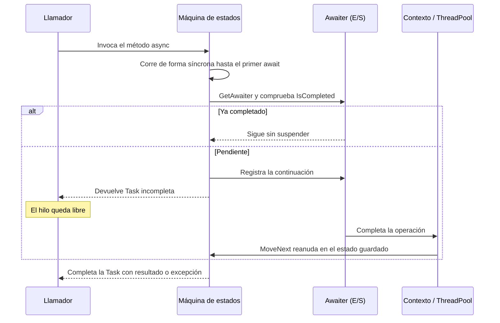

<div align="center">

# 05 · C# 4.0 y 5.0: dinamismo y asincronía

**`dynamic`, varianza genérica, argumentos con nombre y la revolución de `async`/`await` (2010–2012)**

[⬅ 04 · C# 3](04-csharp-3-linq.md) · [🏠 Índice](../README.md) · [06 · C# 6 ➡](06-csharp-6-roslyn.md)

</div>

| Ficha | C# 4.0 | C# 5.0 |
|---|---|---|
| **Publicación** | abril de 2010 | agosto de 2012 |
| **Visual Studio** | VS 2010 | VS 2012 |
| **Runtime** | .NET Framework 4.0 (CLR 4) | .NET Framework 4.5 |
| **`LangVersion` actual** | `4` | `5` |
| **Laboratorio** | [CristianSifuentes/CSharp4](https://github.com/CristianSifuentes/CSharp4) | [CristianSifuentes/CSharp5](https://github.com/CristianSifuentes/CSharp5) |

---

## Contenido

1. [C# 4: `dynamic`](#1-c-4-dynamic)
2. [C# 4: argumentos con nombre y opcionales](#2-c-4-argumentos-con-nombre-y-opcionales)
3. [C# 4: varianza genérica](#3-c-4-varianza-genérica)
4. [C# 4: interoperabilidad COM](#4-c-4-interoperabilidad-com)
5. [C# 5: el problema de la asincronía](#5-c-5-el-problema-de-la-asincronía)
6. [C# 5: la máquina de estados](#6-c-5-la-máquina-de-estados)
7. [C# 5: reglas de producción](#7-c-5-reglas-de-producción)
8. [C# 5: atributos de información del llamador](#8-c-5-atributos-de-información-del-llamador)
9. [C# 5: el cambio en `foreach`](#9-c-5-el-cambio-en-foreach)
10. [Notas de migración](#10-notas-de-migración)
11. [Referencias](#11-referencias)

---

<!-- cs=4 -->

## 1. C# 4: `dynamic`

`dynamic` desactiva la comprobación en compilación para una expresión. En el IL es `object` con un atributo; cada operación se
convierte en un **sitio de llamada** resuelto por el *Dynamic Language Runtime*, que guarda en caché las resoluciones.

```csharp run
class Programa
{
    static void Main()
    {
        dynamic x = "hola";
        Console.WriteLine(x.Length);          // → 4

        x = new List<int> { 1, 2 };
        Console.WriteLine(x.Count);           // → 2

        try
        {
            Console.WriteLine(x.NoExiste);
        }
        catch (Microsoft.CSharp.RuntimeBinder.RuntimeBinderException)
        {
            Console.WriteLine("Error al ejecutar"); // → Error al ejecutar
        }
    }
}
```

| Comparación | `object` | `var` | `dynamic` |
|---|---|---|---|
| Tipo estático | `object` | El inferido | `dynamic` |
| Comprobación | Compilación | Compilación | **Ejecución** |
| IntelliSense | Solo `object` | Completo | Ninguno |
| Costo | Conversiones | Ninguno | Enlace en ejecución |

**Cuándo usarlo:** COM, interoperabilidad con lenguajes dinámicos y formas de datos desconocidas. **Evítalo** en código nuevo de
lógica de negocio, en *trimming* y en Native AOT, donde depende de información de reflexión.

---

## 2. C# 4: argumentos con nombre y opcionales

```csharp run
class Programa
{
    static string Conectar(string host, int puerto = 443, bool seguro = true)
    {
        return host + ":" + puerto + ":" + seguro;
    }

    static void Main()
    {
        Console.WriteLine(Conectar("a"));                  // → a:443:True
        Console.WriteLine(Conectar("a", seguro: false));   // → a:443:False
        Console.WriteLine(Conectar(puerto: 80, host: "b")); // → b:80:True
    }
}
```

> [!WARNING]
> **Riesgo de versionado.** El valor por defecto se copia en el **llamador** al compilar. Si una biblioteca cambia `puerto = 443` a
> `8443` y el consumidor no recompila, sigue enviando `443`. En API públicas de larga vida, las sobrecargas son más seguras.
> El nombre de los parámetros también pasa a formar parte del contrato.

---

## 3. C# 4: varianza genérica

La varianza solo se aplica a interfaces y delegados, y **solo a tipos de referencia**.

| Marca | Nombre | Regla | Ejemplo |
|---|---|---|---|
| `out T` | Covarianza | `T` solo sale | `IEnumerable<string>` → `IEnumerable<object>` |
| `in T` | Contravarianza | `T` solo entra | `Action<object>` → `Action<string>` |

```csharp run
class Programa
{
    static void Main()
    {
        IEnumerable<string> textos = new List<string> { "a", "b" };
        IEnumerable<object> objetos = textos;          // covarianza segura

        Action<object> imprimir = o => Console.WriteLine(o);
        Action<string> soloTexto = imprimir;           // contravarianza
        soloTexto("ok");                               // → ok

        // Los arreglos son covariantes desde C# 1, pero sin esa seguridad:
        object[] arreglo = new string[1];
        try
        {
            arreglo[0] = 1;
        }
        catch (ArrayTypeMismatchException)
        {
            Console.WriteLine("Covarianza insegura"); // → Covarianza insegura
        }
    }
}
```

`List<T>` es **invariante** porque `T` entra y sale; y un tipo de valor no admite la conversión, porque cambiaría la
representación:

```csharp err=CS0266 cuerpo
IEnumerable<int> numeros = new List<int>();
IEnumerable<object> objetos = numeros;  // error CS0266
```

---

## 4. C# 4: interoperabilidad COM

Para automatizar Office, C# 4 combinó cuatro mejoras: argumentos opcionales, `dynamic`, omisión de `ref` en llamadas COM y **tipos de
interoperabilidad incrustados** (*NoPIA*), que copian en tu ensamblado solo los tipos usados y eliminan el despliegue de los
ensamblados de interoperabilidad primarios.

---

<!-- cs=5 -->

## 5. C# 5: el problema de la asincronía

Una interfaz gráfica se congela si bloquea su hilo, y un servidor desperdicia hilos esperando E/S. Pero las soluciones anteriores
partían la lógica en pedazos:

| Modelo | Era | Forma | Problema |
|---|---|---|---|
| **APM** | .NET 1.0 | `BeginRead` / `EndRead` | *Callbacks* e `IAsyncResult` |
| **EAP** | .NET 2.0 | `DownloadAsync` + evento `Completed` | Estado disperso |
| **TPL** | .NET 4.0 | `Task.ContinueWith` | Encadenamiento manual de errores |
| **TAP + `await`** | C# 5 | `await LeerAsync()` | Código lineal |

```csharp cs=4 cuerpo
// Antes: continuaciones manuales; bucles y try/catch dejan de componer
Task<string> tarea = Task.Factory.StartNew(() => "datos");
tarea.ContinueWith(t =>
{
    if (t.IsFaulted) { Console.WriteLine(t.Exception); return; }
    Console.WriteLine(t.Result);
});
```

```csharp run
// Después: el flujo de control vuelve a ser el del lenguaje
class Programa
{
    static async Task<int> SumarAsync(int[] valores)
    {
        int total = 0;
        foreach (int v in valores)
        {
            await Task.Delay(1);   // bucle y await conviven con naturalidad
            total += v;
        }
        return total;
    }

    static void Main()
    {
        Console.WriteLine(SumarAsync(new[] { 1, 2, 3 }).Result); // → 6
    }
}
```

---

## 6. C# 5: la máquina de estados

El compilador reescribe un método `async` como un `struct` con un método `MoveNext`, de forma muy parecida a un
[iterador](03-csharp-2-genericos.md#3-iteradores-con-yield).



| Hecho | Consecuencia |
|---|---|
| `await` **no crea un hilo** | Durante la E/S pendiente, ningún hilo espera |
| El inicio es síncrono | El código previo al primer `await` corre en el hilo del llamador |
| Sin suspensión no hay traslado al *heap* | Si todo completa ya, la máquina permanece en la pila; la `Task` puede seguir asignándose |
| `await` es un **patrón** | Vale cualquier tipo con `GetAwaiter()`, incluso por extensión |
| Las excepciones se capturan en la `Task` | Y se relanzan en el `await` |

> [!NOTE]
> **Runtime Async.** En .NET 11, el propio runtime implementa parte de esta transformación. Según la documentación del RC 2, ya no hace
> falta `EnablePreviewFeatures` para proyectos `net11.0`, con mejores trazas de pila y menos sobrecarga. La semántica de `await`
> en tu código no cambia. Es un buen ejemplo de los relojes de [01](01-modelo-de-versiones.md#1-los-cinco-relojes): mejora el runtime sin cambiar
> el lenguaje.

---

## 7. C# 5: reglas de producción

| Regla | Motivo |
|---|---|
| **Asíncrono de extremo a extremo** | `.Result` o `.Wait()` bloquean un hilo y, con un contexto de un solo hilo, provocan interbloqueos |
| **Evita `async void`** | Solo para manejadores de eventos: sus excepciones no se pueden capturar con `try` en el llamador |
| **`ConfigureAwait(false)` en bibliotecas** | Evita volver al contexto capturado. ASP.NET Core no tiene `SynchronizationContext`, pero tu biblioteca no sabe dónde corre |
| **Propaga `CancellationToken`** | Sin él no hay forma cooperativa de abandonar el trabajo |
| **`Task.WhenAll` para concurrencia** | `await` en un bucle es secuencial |
| **`Task.Run` solo para CPU** | No envuelvas E/S en él |

```csharp run
class Programa
{
    static async Task<int> PasoAsync(int n)
    {
        await Task.Delay(10);
        return n * 2;
    }

    static async Task EjecutarAsync()
    {
        int[] r = await Task.WhenAll(PasoAsync(1), PasoAsync(2)); // en paralelo
        Console.WriteLine(r[0] + r[1]);                           // → 6

        try
        {
            await Task.Run(() => { throw new InvalidOperationException("fallo"); });
        }
        catch (InvalidOperationException e)
        {
            Console.WriteLine(e.Message);                         // → fallo
        }
    }

    static void Main()
    {
        EjecutarAsync().GetAwaiter().GetResult();
    }
}
```

`GetAwaiter().GetResult()` aparece aquí solo porque `async Main` no existió hasta [C# 7.1](07-csharp-7-tuplas-patrones-y-ref.md#7-c-71).

---

## 8. C# 5: atributos de información del llamador

El compilador rellena estos parámetros opcionales en **tiempo de compilación**, sin reflexión ni costo en ejecución:

```csharp run
using System.Runtime.CompilerServices;

class Programa
{
    static void Log(string mensaje, [CallerMemberName] string miembro = "", [CallerLineNumber] int linea = 0)
    {
        Console.WriteLine(miembro + " " + (linea > 0) + " " + mensaje);
    }

    static void Main()
    {
        Log("inicio"); // → Main True inicio
    }
}
```

Su uso clásico es `INotifyPropertyChanged`. La familia se amplió en [C# 10](09-csharp-9-10-records.md) con `CallerArgumentExpression`.

---

## 9. C# 5: el cambio en `foreach`

Antes de C# 5, la variable de `foreach` era **una sola** para todo el bucle, y una clausura veía su valor final. Fue uno de los errores
más reportados del lenguaje, y C# 5 aceptó un cambio de comportamiento: cada iteración tiene su propia variable.

```csharp run
class Programa
{
    static void Main()
    {
        var acciones = new List<Action>();
        foreach (int i in new[] { 1, 2, 3 })
        {
            acciones.Add(() => Console.WriteLine(i));
        }
        foreach (var a in acciones) a();
        // → 1
        // → 2
        // → 3
    }
}
```

> [!CAUTION]
> El cambio **solo afecta a `foreach`**. En un `for`, la variable sigue siendo compartida y las clausuras ven el valor final.

```csharp run
class Programa
{
    static void Main()
    {
        var acciones = new List<Action>();
        for (int i = 0; i < 2; i++)
        {
            acciones.Add(() => Console.WriteLine(i));
        }
        foreach (var a in acciones) a();
        // → 2
        // → 2
    }
}
```

---

## 10. Notas de migración

| Versión | Tema | Acción |
|---|---|---|
| C# 4 | `dynamic` requiere `Microsoft.CSharp` | Ya incluido en .NET moderno; revisar compatibilidad con *trimming* y AOT |
| C# 5 | `async` y `await` son contextuales | El código que los usa como identificadores fuera de métodos `async` sigue compilando |
| C# 5 | Cambio en `foreach` | Revisar código que dependiera, por error, del comportamiento anterior |
| C# 5 | APM y EAP | Encapsular con `Task.Factory.FromAsync` o `TaskCompletionSource<T>` |

---

## 11. Referencias

- [Asynchronous programming](https://learn.microsoft.com/dotnet/csharp/asynchronous-programming/) · [Task-based asynchronous pattern](https://learn.microsoft.com/dotnet/standard/asynchronous-programming-patterns/task-based-asynchronous-pattern-tap)
- [Using type dynamic](https://learn.microsoft.com/dotnet/csharp/advanced-topics/interop/using-type-dynamic) · [Covariance and contravariance](https://learn.microsoft.com/dotnet/standard/generics/covariance-and-contravariance)
- [Caller information](https://learn.microsoft.com/dotnet/csharp/language-reference/attributes/caller-information)
