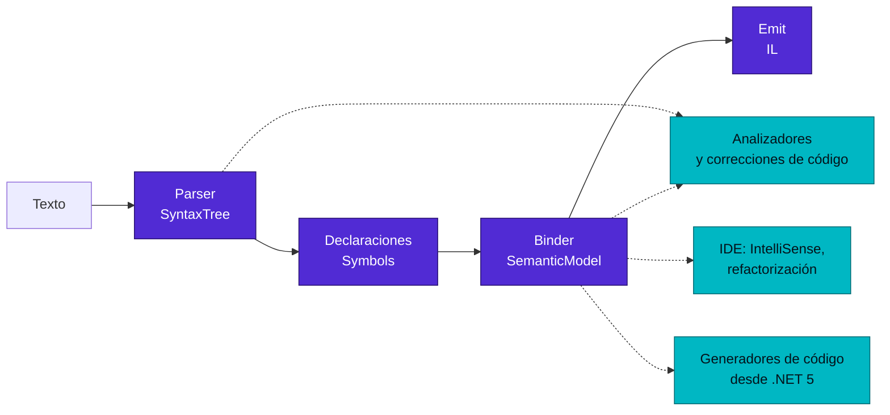

<div align="center">

# 06 · C# 6.0: Roslyn y el fin de la ceremonia

**El compilador se reescribe en C# y se abre; el lenguaje gana docenas de atajos (2015)**

[⬅ 05 · C# 4 y 5](05-csharp-4-5-dinamismo-y-asincronia.md) · [🏠 Índice](../README.md) · [07 · C# 7 ➡](07-csharp-7-tuplas-patrones-y-ref.md)

</div>

<!-- cs=6 -->

| Ficha | C# 6.0 |
|---|---|
| **Publicación** | julio de 2015 |
| **Visual Studio** | VS 2015 |
| **Runtime** | .NET Framework 4.6 |
| **`LangVersion` actual** | `6` |
| **Clase de cambio** | Solo compilador: casi todo es azúcar sintáctico |
| **Laboratorio** | [CristianSifuentes/CSharp6](https://github.com/CristianSifuentes/CSharp6) |

---

## Contenido

1. [Roslyn: el compilador como plataforma](#1-roslyn-el-compilador-como-plataforma)
2. [Antes y después en una clase](#2-antes-y-después-en-una-clase)
3. [Interpolación de cadenas](#3-interpolación-de-cadenas)
4. [Operador condicional nulo](#4-operador-condicional-nulo)
5. [`nameof`](#5-nameof)
6. [Filtros de excepción](#6-filtros-de-excepción)
7. [Otras mejoras](#7-otras-mejoras)
8. [Notas de migración](#8-notas-de-migración)
9. [Referencias](#9-referencias)

---

## 1. Roslyn: el compilador como plataforma

El compilador nativo de C++ era una caja negra. **Roslyn** lo reimplementó en C# (y en Visual Basic para ese lenguaje), publicó su código
y expuso cada fase como una API.



| Consecuencia | Antes | Después |
|---|---|---|
| Diseño del lenguaje | Interno | Público en `dotnet/csharplang` |
| IDE y compilador | Dos analizadores distintos | Una sola fuente de verdad |
| Reglas de estilo | Herramientas externas | Analizadores por NuGet que se ejecutan al compilar |
| Evolución | Costosa | Permite el ciclo rápido de C# 7 en adelante |

---

## 2. Antes y después en una clase

```csharp cs=5
// Antes (C# 5)
class Persona
{
    private readonly string _nombre;
    public string Nombre { get { return _nombre; } }
    public DateTime Alta { get; private set; }

    public Persona(string nombre)
    {
        if (nombre == null) throw new ArgumentNullException("nombre");
        _nombre = nombre;
        Alta = DateTime.UtcNow;
    }

    public override string ToString() { return string.Format("{0} ({1:yyyy})", Nombre, Alta); }
}
```

```csharp
// Después (C# 6)
using static System.Math;

class Persona
{
    public string Nombre { get; }                       // propiedad de solo lectura
    public DateTime Alta { get; } = DateTime.UtcNow;    // inicializador de propiedad
    public int Redondeado => (int)Round(1.5);           // miembro con cuerpo de expresión

    public Persona(string nombre)
    {
        if (nombre == null) throw new ArgumentNullException(nameof(nombre));
        Nombre = nombre;
    }

    public override string ToString() => $"{Nombre} ({Alta:yyyy})";
}
```

---

## 3. Interpolación de cadenas

`$"..."` se traduce a `string.Format` o a concatenación. Las versiones posteriores la convirtieron en una herramienta de rendimiento.

| Versión | Avance |
|---|---|
| C# 6 | `$"{x}"` y `FormattableString` |
| C# 8 | `$@"…"` y `@$"…"` indistintamente |
| C# 10 | Manejadores de interpolación: sin cadenas temporales |
| C# 10 | `const` interpolado cuando las partes son constantes |
| C# 11 | Saltos de línea dentro de `{ }`; cadenas sin formato con `$"""` |

```csharp run
using System.Globalization;

class Programa
{
    static void Main()
    {
        CultureInfo.CurrentCulture = new CultureInfo("es-ES");
        double precio = 1234.5;

        Console.WriteLine($"{precio:N1}");                          // → 1.234,5
        Console.WriteLine(FormattableString.Invariant($"{precio:N1}")); // → 1,234.5
    }
}
```

> [!WARNING]
> **La interpolación usa la cultura actual.** Para nombres de archivo, JSON hecho a mano, SQL o claves de caché, usa
> `FormattableString.Invariant` o, desde .NET 6, `string.Create(CultureInfo.InvariantCulture, $"…")`. Y nunca interpoles SQL:
> usa parámetros.

---

## 4. Operador condicional nulo

```csharp run
class Pedido { public Cliente Cliente; }
class Cliente { public string Nombre; public event EventHandler Cambio; public void Avisar() { Cambio?.Invoke(this, EventArgs.Empty); } }

class Programa
{
    static void Main()
    {
        Pedido p = null;
        Console.WriteLine(p?.Cliente?.Nombre ?? "sin cliente"); // → sin cliente

        int[] datos = null;
        Console.WriteLine(datos?[0] == null);                   // → True

        var c = new Cliente();
        c.Avisar();             // sin suscriptores: no falla
        Console.WriteLine("ok"); // → ok
    }
}
```

| Propiedad | Detalle |
|---|---|
| Cortocircuito | Si el receptor es `null`, **no se evalúa nada más** de la cadena |
| Tipo del resultado | `p?.Edad` con `Edad` de tipo `int` da `int?` |
| Evaluación única | El receptor se evalúa una vez, por lo que `Evento?.Invoke()` no tiene la carrera entre hilos de [C# 1](02-csharp-1-cimientos.md#4-delegados-y-eventos) |
| Alcance | Solo lectura, hasta la [asignación condicional de C# 14](12-csharp-14-extensiones.md) |

---

## 5. `nameof`

Convierte un símbolo en cadena **en compilación**: sobrevive a refactorizaciones y no cuesta nada al ejecutar.

```csharp run
class Programa
{
    public int Total { get; set; }

    static void Main()
    {
        Console.WriteLine(nameof(Total));              // → Total
        Console.WriteLine(nameof(Programa.Total));     // → Total
        Console.WriteLine(nameof(System.Console));     // → Console
    }
}
```

Evolución: en C# 11 alcanza los parámetros de un método desde sus atributos, y en C# 14 acepta genéricos sin enlazar como
`nameof(List<>)`.

---

## 6. Filtros de excepción

`when` se evalúa **antes de desenrollar la pila**. Eso los hace distintos de un `catch` que relanza:

| | `catch { if (…) throw; }` | `catch (…) when (…)` |
|---|---|---|
| Se desenrolla la pila | Sí | **No, si el filtro es falso** |
| Información de depuración | Se pierde el punto exacto | Se conserva para un volcado |
| El siguiente `catch` se evalúa | No | Sí |

```csharp run
class ErrorHttp : Exception
{
    public int Codigo;
    public ErrorHttp(int codigo) { Codigo = codigo; }
}

class Programa
{
    static void Main()
    {
        foreach (int codigo in new[] { 404, 500 })
        {
            try
            {
                throw new ErrorHttp(codigo);
            }
            catch (ErrorHttp e) when (e.Codigo == 404)
            {
                Console.WriteLine("No encontrado"); // → No encontrado
            }
            catch (ErrorHttp e) when (e.Codigo >= 500)
            {
                Console.WriteLine("Reintentar");    // → Reintentar
            }
        }
    }
}
```

---

## 7. Otras mejoras

| Característica | Ejemplo | Nota |
|---|---|---|
| `using static` | `using static System.Math;` | Importa miembros estáticos |
| `await` en `catch` y `finally` | `catch { await LogAsync(); }` | Imposible en C# 5 |
| Inicializador de índice | `new Dictionary<int, string> { [1] = "a" }` | Usa el indexador, no `Add`: una clave repetida no lanza excepción |
| Extensión `Add` | Inicializadores de colección con `Add` por extensión | |
| Resolución mejorada | Mejor elección de sobrecargas con grupos de métodos | |

```csharp run
class Programa
{
    static void Main()
    {
        var a = new Dictionary<string, int> { ["x"] = 1, ["x"] = 2 };
        Console.WriteLine(a["x"]); // → 2

        try
        {
            var b = new Dictionary<string, int> { { "x", 1 }, { "x", 2 } };
        }
        catch (ArgumentException)
        {
            Console.WriteLine("Add rechaza la clave repetida"); // → Add rechaza la clave repetida
        }
    }
}
```

---

## 8. Notas de migración

| Tema | Recomendación |
|---|---|
| Cadenas literales de parámetros | Reemplazar por `nameof` |
| Comprobaciones de `null` en eventos | Reemplazar por `?.Invoke` |
| Campo `readonly` + propiedad | Reemplazar por `{ get; }` |
| Compilador nuevo con código antiguo | Roslyn añadió diagnósticos y corrigió desviaciones del compilador nativo: prueba antes de actualizar |

> [!TIP]
> **Herencia viva.** C# 6 no añadió ninguna capacidad nueva al runtime y, aun así, fue una de las versiones más adoptadas: cuando el
> costo de migrar es cero, una mejora pequeña en cada línea vale más que un gran concepto.

---

## 9. Referencias

- [dotnet/roslyn](https://github.com/dotnet/roslyn) · [The .NET Compiler Platform SDK](https://learn.microsoft.com/dotnet/csharp/roslyn-sdk/)
- [String interpolation](https://learn.microsoft.com/dotnet/csharp/language-reference/tokens/interpolated) · [Null-conditional operators](https://learn.microsoft.com/dotnet/csharp/language-reference/operators/member-access-operators#null-conditional-operators--and-)
- [nameof](https://learn.microsoft.com/dotnet/csharp/language-reference/operators/nameof) · [Exception filters](https://learn.microsoft.com/dotnet/csharp/language-reference/statements/exception-handling-statements)
