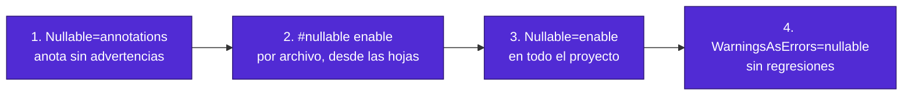

<div align="center">

# 08 · C# 8.0: nulabilidad y flujos asíncronos

**Tipos de referencia anulables, patrones recursivos, `IAsyncEnumerable<T>` e interfaces con implementación (2019)**

[⬅ 07 · C# 7](07-csharp-7-tuplas-patrones-y-ref.md) · [🏠 Índice](../README.md) · [09 · C# 9 y 10 ➡](09-csharp-9-10-records.md)

</div>

<!-- cs=8 -->

| Ficha | C# 8.0 |
|---|---|
| **Publicación** | septiembre de 2019 |
| **Visual Studio** | VS 2019 16.3 |
| **Runtime** | .NET Core 3.0 |
| **`LangVersion` actual** | `8.0` |
| **Clase de cambio** | Mixta: compilador, biblioteca y **runtime** |
| **Laboratorio** | [CristianSifuentes/CSharp8](https://github.com/CristianSifuentes/CSharp8) |

> [!IMPORTANT]
> Es la primera versión de C# orientada a **.NET Core**. Los miembros de interfaz por defecto requieren cambios en el CLR, y los índices,
> rangos y flujos asíncronos requieren tipos nuevos. Por eso .NET Framework se quedó en C# 7.3 por defecto.

---

## Contenido

1. [Tipos de referencia anulables](#1-tipos-de-referencia-anulables)
2. [Expresiones `switch` y patrones recursivos](#2-expresiones-switch-y-patrones-recursivos)
3. [Flujos asíncronos](#3-flujos-asíncronos)
4. [Índices y rangos](#4-índices-y-rangos)
5. [Miembros de interfaz por defecto](#5-miembros-de-interfaz-por-defecto)
6. [Declaraciones `using` y `await using`](#6-declaraciones-using-y-await-using)
7. [Otras mejoras](#7-otras-mejoras)
8. [Notas de migración](#8-notas-de-migración)
9. [Referencias](#9-referencias)

---

## 1. Tipos de referencia anulables

### El problema

Tony Hoare llamó a la referencia nula su "error de los mil millones de dólares". En C# 7, `string` significaba a la vez "texto" y "tal vez
nada", y `NullReferenceException` era la excepción más común.

```csharp warn=CS8602 cuerpo
// Con el contexto anulable activado
string? nombre = Environment.GetEnvironmentVariable("NOMBRE");
Console.WriteLine(nombre.Length);    // advertencia CS8602
```

```csharp cuerpo
string? nombre = Environment.GetEnvironmentVariable("NOMBRE");
if (nombre != null)
{
    Console.WriteLine(nombre.Length);  // análisis de flujo: aquí es no nulo
}
Console.WriteLine(nombre?.Length ?? 0);
```

### Semántica: es análisis estático

| Hecho | Consecuencia |
|---|---|
| `string?` y `string` son **el mismo tipo en ejecución** | No hay comprobación ni costo; `typeof(string?)` no existe |
| Solo produce **advertencias** | Actívalas como errores con `<WarningsAsErrors>nullable</WarningsAsErrors>` |
| Se basa en flujo de datos | Sigue comprobaciones, asignaciones y patrones |
| Tiene límites | Arreglos, `default` en `struct` y deserialización pueden colar `null` |

| Herramienta | Uso |
|---|---|
| `string?` | Puede ser nulo |
| `x!` | "Confía en mí": silencia la advertencia, **sin** comprobación en ejecución |
| `[NotNullWhen(true)]` | Si devuelve `true`, el argumento no es nulo |
| `[MaybeNullWhen(false)]` | Salida de un patrón `TryGet` |
| `[MemberNotNull(nameof(x))]` | Un método auxiliar inicializa el campo |
| `#nullable enable` | Activar archivo a archivo |

```csharp run
using System.Diagnostics.CodeAnalysis;

class Cache
{
    private readonly Dictionary<string, string> _d = new Dictionary<string, string> { ["a"] = "1" };

    public bool TryGet(string clave, [NotNullWhen(true)] out string? valor) =>
        _d.TryGetValue(clave, out valor);
}

class Programa
{
    static void Main()
    {
        if (new Cache().TryGet("a", out var v))
        {
            Console.WriteLine(v.Length); // → 1
        }
    }
}
```

### Estrategia de adopción



> [!TIP]
> Empieza por los proyectos sin dependencias internas, y evita llenar el código de `!`: cada uno es una promesa sin comprobar.

---

## 2. Expresiones `switch` y patrones recursivos

C# 7 dio el `case` por tipo. C# 8 convirtió `switch` en una **expresión** y dejó que los patrones se anidaran.

```csharp run
class Pedido { public string Pais = ""; public decimal Total; public Cliente? Cliente; }
class Cliente { public bool Premium; }

class Programa
{
    static decimal Envio(Pedido p) => p switch
    {
        { Cliente: { Premium: true } } => 0m,                  // patrón de propiedad anidado
        { Pais: "MX", Total: var t } when t > 1000 => 0m,
        { Pais: "MX" } => 50m,
        _ => 200m,
    };

    static string Estado(bool pagado, bool enviado) => (pagado, enviado) switch
    {
        (false, _) => "pendiente",   // patrón de tupla
        (true, false) => "preparando",
        (true, true) => "enviado",
    };

    static void Main()
    {
        Console.WriteLine(Envio(new Pedido { Pais = "MX", Total = 10 })); // → 50
        Console.WriteLine(Estado(true, false));                          // → preparando
    }
}
```

| Patrón | Sintaxis | Requisito |
|---|---|---|
| De propiedad | `{ Pais: "MX" }` | Comprueba además que no es `null` |
| Posicional | `(1, var y)` | Un método `Deconstruct` o una tupla |
| De tupla | `(a, b) switch` | Combinar varias entradas |
| `var` | `var x` | Siempre coincide, y captura |

Una expresión `switch` sin coincidencia lanza `SwitchExpressionException`, y el compilador advierte con CS8509 si no es exhaustiva.

---

## 3. Flujos asíncronos

`IEnumerable<T>` bloquea entre elementos, y `Task<List<T>>` espera a tenerlos todos. `IAsyncEnumerable<T>` une lo mejor de
[`yield`](03-csharp-2-genericos.md#3-iteradores-con-yield) y [`await`](05-csharp-4-5-dinamismo-y-asincronia.md).

```csharp run
using System.Runtime.CompilerServices;

class Programa
{
    static async IAsyncEnumerable<int> Lecturas(
        int total,
        [EnumeratorCancellation] CancellationToken ct = default)
    {
        for (int i = 1; i <= total; i++)
        {
            await Task.Delay(1, ct);  // E/S simulada
            yield return i * 10;
        }
    }

    static async Task Main()
    {
        await foreach (int valor in Lecturas(2))
        {
            Console.WriteLine(valor);
            // → 10
            // → 20
        }
    }
}
```

`[EnumeratorCancellation]` conecta el *token* pasado con `.WithCancellation(ct)` al parámetro del iterador. Sin el atributo, ese *token* no llega al iterador, y el compilador lo advierte con CS8425.

---

## 4. Índices y rangos

```csharp run
class Programa
{
    static void Main()
    {
        int[] a = { 0, 1, 2, 3, 4 };
        Console.WriteLine(a[^1]);          // → 4
        Console.WriteLine(a[1..3].Length); // → 2
        Console.WriteLine("atlas"[..2]);   // → at

        Index i = ^2;
        Range r = 1..^1;
        Console.WriteLine(a[i]);           // → 3
        Console.WriteLine(a[r].Length);    // → 3
    }
}
```

| Semántica | Detalle |
|---|---|
| `^1` | **Último** elemento, no el penúltimo: `^0` queda fuera |
| `a..b` | `b` es exclusivo |
| Rango en arreglo | **Crea un arreglo nuevo** con una copia |
| Rango en `Span<T>` | Segmenta sin copiar |
| Rango en `string` | `Substring`: crea una cadena |

> [!WARNING]
> `arreglo[1..3]` asigna memoria. En una ruta crítica usa `arreglo.AsSpan(1, 2)` o `arreglo.AsSpan()[1..3]`.

---

## 5. Miembros de interfaz por defecto

Permiten **añadir un miembro a una interfaz publicada sin romper a quienes la implementan**. Requieren soporte del runtime: no funcionan en
.NET Framework.

```csharp run
interface IRegistro
{
    void Escribir(string m);
    void Error(string m) => Escribir("ERROR " + m);   // añadido en la versión 2
}

class Consola : IRegistro
{
    public void Escribir(string m) => Console.WriteLine(m);
}

class Programa
{
    static void Main()
    {
        IRegistro r = new Consola();
        r.Error("disco");    // → ERROR disco
    }
}
```

La clase **no hereda** ese miembro: solo existe a través de la interfaz.

```csharp err=CS1061
interface IRegistro { void Error(string m) => Console.WriteLine(m); }
class Consola : IRegistro { }
class Programa { static void Main() { new Consola().Error("x"); } }  // error CS1061
```

---

## 6. Declaraciones `using` y `await using`

```csharp cs=7.3 cuerpo
// Antes: un nivel de sangría por recurso
using (var a = new MemoryStream())
using (var b = new StreamReader(a))
{
    Console.WriteLine(b.ReadToEnd());
}
```

```csharp cuerpo
// Después: Dispose al final del ámbito, en orden inverso
using var a = new MemoryStream();
using var b = new StreamReader(a);
Console.WriteLine(b.ReadToEnd());
```

> [!WARNING]
> Una declaración `using` extiende el recurso **hasta el final del bloque**. Si después hay trabajo largo, una conexión queda ocupada más
> tiempo. En ese caso, conserva la forma con llaves. El mismo ámbito se aplica a `await using`, que llama a `DisposeAsync`.

---

## 7. Otras mejoras

| Característica | Ejemplo | Por qué importa |
|---|---|---|
| Miembros `readonly` | `readonly double Largo() => …` | Evita la [copia defensiva](07-csharp-7-tuplas-patrones-y-ref.md#la-trampa-de-la-copia-defensiva) método a método |
| `??=` | `lista ??= new();` | Inicialización diferida |
| Funciones locales `static` | `static int F(int x) => x;` | Garantizan que no se captura nada |
| `ref struct` desechables | Un método `Dispose` sin interfaz | `using` funciona por patrón |
| Tipos construidos no administrados | `Par<int>` cumple `unmanaged` | Genéricos sobre memoria nativa |
| `stackalloc` anidado | `Span<int> s = …; M(stackalloc int[3]);` | Sin variable intermedia |
| Cadenas | `@$"…"` y `$@"…"` | Ambos órdenes |

---

## 8. Notas de migración

| Tema | Recomendación |
|---|---|
| `.NET Framework` | C# 8 no está soportado de forma oficial. Parte del lenguaje compila, pero no lo que requiere runtime |
| .NET Standard 2.0 | Lo que depende de `Index`, `Range` o `IAsyncEnumerable<T>` necesita paquetes o *polyfills* |
| Contexto anulable | Tratar como un proyecto propio: es muy ruidoso en bases de código grandes |
| Anotaciones en bibliotecas | Cambiarlas altera las advertencias de tus consumidores |
| `switch` antiguo | Convertir los que solo asignan o devuelven; el análisis de CS8509 pasa a proteger los casos |

---

## 9. Referencias

- [Nullable reference types](https://learn.microsoft.com/dotnet/csharp/nullable-references) · [Nullable migration strategies](https://learn.microsoft.com/dotnet/csharp/nullable-migration-strategies)
- [Patterns](https://learn.microsoft.com/dotnet/csharp/language-reference/operators/patterns) · [Asynchronous streams](https://learn.microsoft.com/dotnet/csharp/asynchronous-programming/generate-consume-asynchronous-stream)
- [Default interface methods](https://learn.microsoft.com/dotnet/csharp/advanced-topics/interface-implementation/default-interface-methods-versions)
