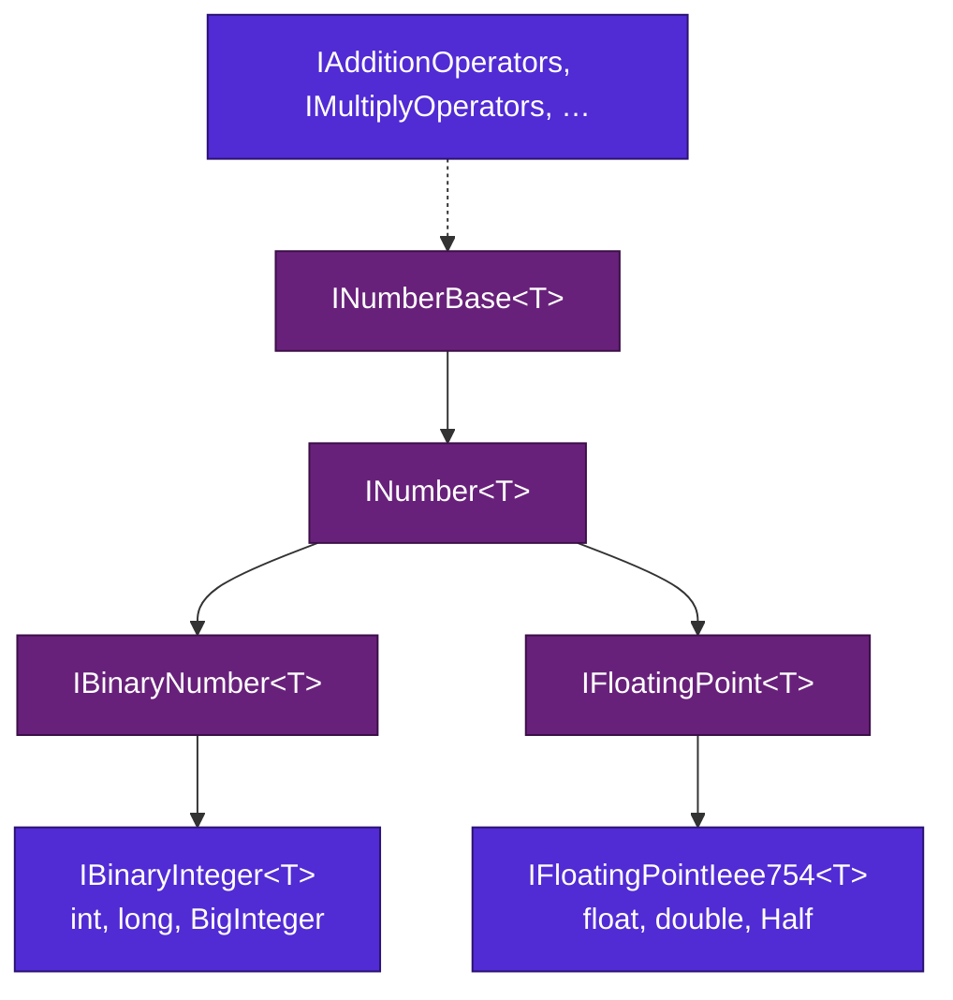

<div align="center">

# 10 · C# 11: matemática genérica

**Miembros `static abstract`, cadenas sin formato, patrones de lista, `required` y campos `ref` (2022)**

[⬅ 09 · C# 9 y 10](09-csharp-9-10-records.md) · [🏠 Índice](../README.md) · [11 · C# 12 y 13 ➡](11-csharp-12-13-colecciones.md)

</div>

<!-- cs=11 -->

| Ficha | C# 11 |
|---|---|
| **Publicación** | noviembre de 2022 |
| **Visual Studio** | VS 2022 17.4 |
| **Runtime** | .NET 7 (8-nov-2022) |
| **`LangVersion` actual** | `11.0` |
| **Clase de cambio** | **Runtime** (`static abstract`, campos `ref`) y compilador |
| **Laboratorio** | [CristianSifuentes/CSharp11](https://github.com/CristianSifuentes/CSharp11) |

---

## Contenido

1. [Matemática genérica](#1-matemática-genérica)
2. [Cadenas: sin formato, UTF-8 e interpolación](#2-cadenas-sin-formato-utf-8-e-interpolación)
3. [Patrones de lista](#3-patrones-de-lista)
4. [`required`](#4-required)
5. [Campos `ref` y `scoped`](#5-campos-ref-y-scoped)
6. [Atributos genéricos y tipos `file`](#6-atributos-genéricos-y-tipos-file)
7. [Otras mejoras](#7-otras-mejoras)
8. [Notas de migración](#8-notas-de-migración)
9. [Referencias](#9-referencias)

---

## 1. Matemática genérica

### El problema de 17 años

Desde [C# 2](03-csharp-2-genericos.md#23-restricciones), `a + b` con `T` era imposible: los operadores son estáticos y las interfaces no podían
declarar miembros estáticos. La solución era copiar el mismo algoritmo para `int`, `long`, `float`, `double`, `decimal`…

### La solución

Tres piezas se combinan:

| Pieza | Capa | Papel |
|---|---|---|
| `static abstract` en interfaces | Lenguaje y **CLR** | Una interfaz exige miembros estáticos |
| Operadores `checked` definidos por el usuario | Lenguaje | `checked(a + b)` respeta el contexto |
| `INumber<T>` y familia | Biblioteca (.NET 7) | Cada tipo numérico implementa las interfaces |

```csharp run
using System.Numerics;

Console.WriteLine(Sumar(new[] { 1, 2, 3 }));      // → 6
Console.WriteLine(Sumar(new[] { 1.5, 2.5 }));     // → 4
Console.WriteLine(Sumar(new decimal[] { 0.1m, 0.2m })); // → 0.3

static T Sumar<T>(T[] datos) where T : INumber<T>
{
    T total = T.Zero;                 // miembro estático a través de T
    foreach (T d in datos) total += d;
    return total;
}
```



### Sin costo de abstracción

Como vimos en [C# 2](03-csharp-2-genericos.md#22-reificación-la-decisión-que-separó-a-c-de-java), el JIT especializa los genéricos para cada tipo de valor. `T.Zero`
y `+` se resuelven a la instrucción nativa: **no hay** interfaz en ejecución, ni *boxing*.

> [!TIP]
> **Caso real en este repositorio.** [`Matrix.cs`](../Matrix.cs) declara `Matrix<T> where T : unmanaged, INumber<T>`. Con una única implementación,
> la multiplicación concurrente sirve para `double`, `float` o `decimal`: es exactamente lo que C# 11 hizo posible.

Las interfaces también admiten un patrón útil fuera de las matemáticas:

```csharp run
Console.WriteLine(Fabrica<Moneda>.Crear("MXN").Codigo); // → MXN

interface IParseable<TSelf> where TSelf : IParseable<TSelf>
{
    static abstract TSelf Parsear(string texto);
}

record Moneda(string Codigo) : IParseable<Moneda>
{
    public static Moneda Parsear(string texto) => new(texto);
}

static class Fabrica<T> where T : IParseable<T>
{
    public static T Crear(string s) => T.Parsear(s);  // polimorfismo estático
}
```

También se añadieron `>>>` (desplazamiento a la derecha sin signo) y una regla más flexible para el operando derecho de los desplazamientos.

---

## 2. Cadenas: sin formato, UTF-8 e interpolación

### Cadenas sin formato

```csharp cs=10 cuerpo
// Antes: escapar comillas y barras
string json = "{\n  \"ruta\": \"C:\\\\datos\"\n}";
```

```csharp run
string ruta = "C:\\datos";
string json = $$"""
    {
      "ruta": "{{ruta}}",
      "activo": true
    }
    """;
Console.WriteLine(json.Split('\n')[0]); // → {
```

| Regla | Detalle |
|---|---|
| Delimitador | Tres o más `"`; se usan más si el contenido contiene `"""` |
| Sangría | La posición del `"""` final **se elimina** de todas las líneas |
| Interpolación | El número de `$` fija cuántas llaves abren: `$$"""{{x}}"""` deja `{` y `}` como texto, ideal para JSON |

### UTF-8

`"texto"u8` produce un `ReadOnlySpan<byte>` en compilación: los *bytes* se incrustan en el ensamblado. Sirve para protocolos web, donde convertir
con `Encoding.UTF8.GetBytes` en cada llamada no tiene sentido.

```csharp run
ReadOnlySpan<byte> metodo = "GET"u8;
Console.WriteLine(metodo.Length);  // → 3
Console.WriteLine(metodo[0]);      // → 71
```

Además, las interpolaciones admiten saltos de línea dentro de `{ }`, y un `Span<char>` puede compararse con una constante `string` en un patrón.

---

## 3. Patrones de lista

Funcionan con cualquier tipo contable e indexable: arreglos, `List<T>`, `Span<T>`.

```csharp run
Console.WriteLine(Analizar(new[] { 1 }));          // → uno: 1
Console.WriteLine(Analizar(new[] { 1, 2, 3 }));    // → de 1 a 3
Console.WriteLine(Analizar(Array.Empty<int>()));   // → vacío

string[] ruta = "api/v1/pedidos".Split('/');
if (ruta is ["api", var version, .. var resto])
{
    Console.WriteLine($"{version} {resto.Length}"); // → v1 1
}

static string Analizar(int[] datos) => datos switch
{
    [] => "vacío",
    [var x] => $"uno: {x}",
    [var a, .., var z] => $"de {a} a {z}",
};
```

| Elemento | Significado |
|---|---|
| `[1, 2]` | Longitud exacta |
| `_` | Cualquier elemento |
| `..` | Cero o más elementos; solo uno por patrón |
| `.. var r` | Captura el segmento: **copia** en un arreglo, no en un `Span<T>` |

Consecuencia del diseño: el compilador asume que `Length` y `Count` **no son negativos**, por lo que `{ Length: -1 }` es un error.

---

## 4. `required`

Los inicializadores eran opcionales, y con el contexto anulable activo eso obligaba a escribir `= null!`. `required` traslada la obligación al llamador:

```csharp err=CS9035
var c = new Cliente();              // error CS9035: falta Nombre

public class Cliente
{
    public required string Nombre { get; init; }
}
```

```csharp run
using System.Diagnostics.CodeAnalysis;

var a = new Cliente { Nombre = "Ana" };
var b = new Cliente("Luis");
Console.WriteLine(a.Nombre + b.Nombre);  // → AnaLuis

public class Cliente
{
    public required string Nombre { get; init; }

    public Cliente() { }

    [SetsRequiredMembers]                // este constructor se responsabiliza
    public Cliente(string nombre) => Nombre = nombre;
}
```

---

## 5. Campos `ref` y `scoped`

`Span<T>` necesitaba un truco interno del runtime para guardar una referencia. C# 11 y .NET 7 lo convirtieron en una característica normal: un `ref struct`
puede tener **campos `ref`**.

```csharp run
int valor = 1;
var c = new Celda(ref valor);
c.Poner(5);
Console.WriteLine(valor);  // → 5

ref struct Celda
{
    private ref int _destino;                  // campo ref
    public Celda(ref int destino) => _destino = ref destino;
    public void Poner(int v) => _destino = v;
}
```

`scoped` declara que una referencia **no escapa** del método. Esto es lo que permite pasar datos de la pila con seguridad.

```csharp run
Console.WriteLine(Contar(stackalloc int[] { 1, 2 })); // → 2

static int Contar(scoped ReadOnlySpan<int> datos)   // promesa: no se guardará
{
    return datos.Length;
}
```

> [!IMPORTANT]
> Estas reglas endurecieron el análisis de referencias, y **es el mayor foco de cambios incompatibles de C# 11**. Un método de instancia de un
> `ref struct` se presume capaz de capturar argumentos `ref`. Si el compilador reporta CS8350 o CS8347, la solución suele ser añadir `scoped`.
> Consulta [18 § C# 11](18-migracion-y-ciclo-de-vida.md#c-11).

---

## 6. Atributos genéricos y tipos `file`

```csharp cs=10 cuerpo
// Antes: un Type que el compilador no puede restringir
var a = typeof(string);
```

```csharp
[Validador<int>]
public class Modelo { }

public class ValidadorAttribute<T> : Attribute { }

file class Auxiliar                 // visible solo en este archivo
{
    public int Valor => 1;
}
```

Los argumentos de tipo deben estar totalmente definidos en metadatos: no valen `dynamic`, `string?` ni tuplas con nombre. Los tipos `file` evitan que
dos generadores de código colisionen por el nombre de un tipo auxiliar.

---

## 7. Otras mejoras

| Característica | Efecto |
|---|---|
| `struct` con valor por defecto automático | El compilador pone a cero los campos sin asignar en un constructor |
| Conversión de grupos de métodos en caché | Reutiliza el delegado, ahorrando asignaciones |
| `nint`, `nuint` | Alias exactos de `IntPtr`, `UIntPtr` |
| Ámbito de `nameof` extendido | `[Attr(nameof(parametro))]` |
| Ola de advertencias 7 | Avisa de tipos en minúsculas ASCII, reservados para palabras clave futuras |

---

## 8. Notas de migración

| Tema | Acción |
|---|---|
| Tipos llamados `required`, `scoped`, `file` | Ya no están permitidos sin `@` |
| Tipos en minúsculas | CS8981: renómbralos para evitar conflictos, porque son el espacio reservado de las palabras clave |
| `checked` con `IntPtr` | Las operaciones pueden lanzar por desbordamiento: revisa |
| `{ Count: < 0 }` en un `switch` | Ahora es un error por inalcanzable: bórralo |
| Código con `ref struct` y `out` | Revisar los nuevos errores de escape; añadir `scoped` o `[UnscopedRef]` |
| `.NET 7` | **Sin soporte** desde mayo de 2024 |

---

## 9. Referencias

- [Generic math](https://learn.microsoft.com/dotnet/standard/generics/math) · [Static abstract interface members](https://learn.microsoft.com/dotnet/csharp/language-reference/keywords/interface#static-abstract-and-virtual-members)
- [Raw string literals](https://learn.microsoft.com/dotnet/csharp/language-reference/tokens/raw-string) · [List patterns](https://learn.microsoft.com/dotnet/csharp/language-reference/operators/patterns#list-patterns)
- [required modifier](https://learn.microsoft.com/dotnet/csharp/language-reference/keywords/required) · [ref fields](https://learn.microsoft.com/dotnet/csharp/language-reference/builtin-types/ref-struct#ref-fields)
