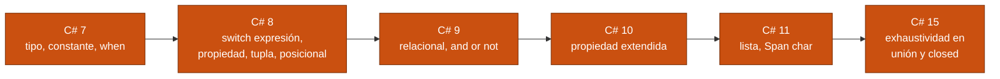
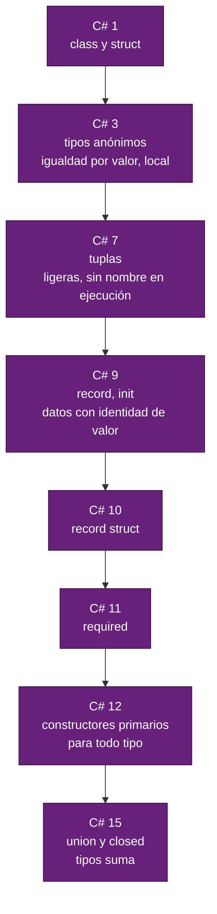
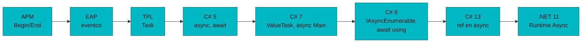

<div align="center">

# 14 · Hilos evolutivos

**Ocho ideas que cruzan todas las versiones: cómo una característica de hoy se construyó durante veinte años**

[⬅ 13 · C# 15](13-csharp-15-uniones.md) · [🏠 Índice](../README.md) · [15 · Bajo el capó ➡](15-bajo-el-capo-y-rendimiento.md)

</div>

> [!TIP]
> Los capítulos 02–13 leen la historia por **versión**. Este la lee por **idea**. Si quieres entender por qué existe algo, empieza aquí.

---

## Contenido

1. [Un mismo programa en cinco épocas](#1-un-mismo-programa-en-cinco-épocas)
2. [Pattern matching](#2-pattern-matching)
3. [Nulabilidad](#3-nulabilidad)
4. [Modelado de datos](#4-modelado-de-datos)
5. [Funciones](#5-funciones)
6. [Asincronía](#6-asincronía)
7. [Memoria segura y rápida](#7-memoria-segura-y-rápida)
8. [Colecciones](#8-colecciones)
9. [Extensiones y código generado](#9-extensiones-y-código-generado)
10. [Matriz de hilos por versión](#10-matriz-de-hilos-por-versión)

---

## 1. Un mismo programa en cinco épocas

Dada una lista de personas, imprimir en orden los nombres de los mayores de edad. Cada bloque se compiló con su versión real.

**C# 1 (2002).** Tipos a mano, conversiones y comparador propio.

```csharp cs=1 run
using System.Collections;

class Persona
{
    private string _nombre;
    private int _edad;
    public Persona(string nombre, int edad) { _nombre = nombre; _edad = edad; }
    public string Nombre { get { return _nombre; } }
    public int Edad { get { return _edad; } }
}

class PorNombre : IComparer
{
    public int Compare(object a, object b)
    {
        return string.Compare(((Persona)a).Nombre, ((Persona)b).Nombre);
    }
}

class Programa
{
    static void Main()
    {
        ArrayList personas = new ArrayList();
        personas.Add(new Persona("Zoe", 30));
        personas.Add(new Persona("Ana", 25));
        personas.Add(new Persona("Leo", 12));

        ArrayList adultos = new ArrayList();
        foreach (Persona p in personas)
        {
            if (p.Edad >= 18) adultos.Add(p);
        }
        adultos.Sort(new PorNombre());

        foreach (Persona p in adultos)
        {
            Console.WriteLine(p.Nombre);
            // → Ana
            // → Zoe
        }
    }
}
```

**C# 3 (2007).** LINQ: de cómo hacerlo a qué se quiere.

```csharp cs=3 run
class Persona
{
    public string Nombre { get; set; }
    public int Edad { get; set; }
}

class Programa
{
    static void Main()
    {
        var personas = new List<Persona>
        {
            new Persona { Nombre = "Zoe", Edad = 30 },
            new Persona { Nombre = "Ana", Edad = 25 },
            new Persona { Nombre = "Leo", Edad = 12 }
        };

        var adultos = from p in personas
                      where p.Edad >= 18
                      orderby p.Nombre
                      select p.Nombre;

        foreach (var n in adultos)
        {
            Console.WriteLine(n);
            // → Ana
            // → Zoe
        }
    }
}
```

**C# 9 (2020).** `record`, sin clase de programa.

```csharp cs=9 run
var personas = new List<Persona> { new("Zoe", 30), new("Ana", 25), new("Leo", 12) };

foreach (var n in personas.Where(p => p.Edad >= 18).OrderBy(p => p.Nombre).Select(p => p.Nombre))
{
    Console.WriteLine(n);
    // → Ana
    // → Zoe
}

record Persona(string Nombre, int Edad);
```

**C# 12 (2023).** Expresiones de colección.

```csharp cs=12 run
List<Persona> personas = [new("Zoe", 30), new("Ana", 25), new("Leo", 12)];

personas.Where(p => p is { Edad: >= 18 })
        .OrderBy(p => p.Nombre)
        .ToList()
        .ForEach(p => Console.WriteLine(p.Nombre));
// → Ana
// → Zoe

record Persona(string Nombre, int Edad);
```

**C# 14 (2025).** Una propiedad de extensión expresa el concepto del dominio.

```csharp cs=14 run
List<Persona> personas = [new("Zoe", 30), new("Ana", 25), new("Leo", 12)];

foreach (var p in personas.Where(p => p.EsAdulto).OrderBy(p => p.Nombre))
{
    Console.WriteLine(p.Nombre);
    // → Ana
    // → Zoe
}

record Persona(string Nombre, int Edad);

static class Dominio
{
    extension(Persona p)
    {
        public bool EsAdulto => p.Edad >= 18;
    }
}
```

De más de 40 líneas a menos de 20, y **ganando seguridad de tipos**: el `(Persona)a` de C# 1 podía fallar en ejecución.

---

## 2. Pattern matching



```csharp cs=15 run
Console.WriteLine(Evaluar(new Solicitud("MX", [1, 2], 100)));  // → regla A
Console.WriteLine(Evaluar(new Solicitud("US", [], 5)));        // → regla C

static string Evaluar(Solicitud s) => s switch
{
    { Pais: "MX", Lista: [_, ..], Total: >= 50 and < 500 } => "regla A",  // C# 8, 9, 11
    { Total: > 1000 } => "regla B",
    _ => "regla C",
};

record Solicitud(string Pais, int[] Lista, int Total);
```

| Versión | Aporta | Pregunta que responde |
|---|---|---|
| C# 7 | `is T x`, `case T x when` | ¿De qué tipo es? |
| C# 8 | `switch` expresión, `{ P: v }`, `(a, b)` | ¿Qué forma tiene? |
| C# 9 | `> 5`, `and`, `or`, `not` | ¿En qué rango está? |
| C# 11 | `[a, .., z]` | ¿Qué contiene? |
| C# 15 | `union`, `closed` | ¿He cubierto **todos** los casos? |

---

## 3. Nulabilidad

| Versión | Sintaxis | Qué resuelve |
|---|---|---|
| C# 2 | `int?`, `??` | Tipos de valor sin dato |
| C# 6 | `?.`, `?[]` | Lectura segura |
| C# 7 | `?? throw` | Validación compacta |
| C# 8 | `string?`, `!`, `??=` | Análisis estático de referencias |
| C# 9 | `is not null` | Comprobación sin sobrecarga de `==` |
| C# 11 | `required` | No más `= null!` |
| C# 14 | `x?.Y = z` | Escritura segura |
| C# 15 | `null` en uniones | `default` como caso explícito |

---

## 4. Modelado de datos



La llegada de `union` completa los dos tipos algebraicos clásicos: los **tipos producto** (A *y* B: `record`, tuplas) y los **tipos suma** (A *o* B: uniones). Lenguajes funcionales como F# y ML
los ofrecían desde siempre, y C# tardó veinticuatro años en tener ambos de forma nativa.

---

## 5. Funciones

| Versión | Paso |
|---|---|
| C# 1 | Delegados con nombre |
| C# 2 | Métodos anónimos y clausuras |
| C# 3 | Lambdas, `Func<>`, `Action<>`, árboles de expresión |
| C# 7 | Funciones locales |
| C# 8 | Funciones locales `static` |
| C# 9 | Lambdas `static`, descartes, punteros a función |
| C# 10 | Tipo natural, tipo de retorno y atributos en lambdas |
| C# 12 | Valores por defecto en lambdas |
| C# 14 | Modificadores sin tipos |

---

## 6. Asincronía



Nota de este hilo: el último salto **no cambia el lenguaje**. Runtime Async mueve al runtime parte de lo que el compilador hacía desde 2012.

---

## 7. Memoria segura y rápida

El hilo más constante desde 2017: acercar C# al rendimiento de C **sin** abandonar la seguridad.

| Versión | Hito | Qué elimina |
|---|---|---|
| C# 1 | `unsafe`, `stackalloc` | Los límites del IL verificable, a costa de la seguridad |
| C# 2 | Genéricos | *Boxing* en colecciones |
| C# 7 | `ref` locales y retornos, `ValueTask` | Copias, asignaciones |
| C# 7.2 | `Span<T>`, `in`, `readonly struct`, `ref struct` | Copias de arreglos y subcadenas |
| C# 7.3 | `stackalloc` inicializado, `unmanaged` | `unsafe` en casos habituales |
| C# 8 | Miembros `readonly` | Copias defensivas |
| C# 9 | `nint`, punteros a función, `SkipLocalsInit` | Delegados, inicialización |
| C# 10 | Manejadores de interpolación | Cadenas temporales |
| C# 11 | Campos `ref`, `scoped`, `u8`, matemática genérica | Trucos internos, conversiones |
| C# 12 | `[InlineArray]` | Búferes `unsafe` |
| C# 13 | `params ReadOnlySpan<T>`, `allows ref struct`, `Lock` | Arreglos de `params` |
| C# 14 | Conversiones implícitas de `Span`, `+=` en el sitio | `.AsSpan()`, copias |
| C# 15 | Seguridad de memoria (*preview*) | La falsa frontera de `unsafe` |

---

## 8. Colecciones

```csharp cs=15 run
// Veinte años de sintaxis para lo mismo, y todos son válidos hoy
System.Collections.ArrayList a = new System.Collections.ArrayList(); a.Add(1);  // C# 1
List<int> b = new List<int>(); b.Add(1);                                        // C# 2
var c = new List<int> { 1 };                                                    // C# 3
List<int> d = new() { 1 };                                                      // C# 9
List<int> e = [1];                                                              // C# 12
List<int> f = [with(capacity: 8), 1];                                           // C# 15
Console.WriteLine(a.Count + b.Count + c.Count + d.Count + e.Count + f.Count);   // → 6
```

---

## 9. Extensiones y código generado

| Hilo | C# 2 | C# 3 | C# 9 | C# 11 | C# 12 | C# 13 | C# 14 | C# 15 |
|---|---|---|---|---|---|---|---|---|
| **Extender tipos ajenos** | — | Métodos | `GetEnumerator` | — | — | — | Propiedades, estáticos, operadores | Indexadores |
| **Generación de código** | `partial class` | Métodos parciales | Generadores, parciales ampliados | Tipos `file` | Interceptores | Propiedades parciales | Constructores y eventos parciales | — |

Los generadores sustituyen a la reflexión en ejecución y hacen viable Native AOT. Casi cada ampliación de `partial` desde 2020 existe para ellos.

---

## 10. Matriz de hilos por versión

● cambio mayor · ○ mejora

| Hilo | 1 | 2 | 3 | 4 | 5 | 6 | 7 | 8 | 9 | 10 | 11 | 12 | 13 | 14 | 15 |
|---|:-:|:-:|:-:|:-:|:-:|:-:|:-:|:-:|:-:|:-:|:-:|:-:|:-:|:-:|:-:|
| Tipos y genéricos | ● | ● |  | ○ |  |  | ○ | ○ |  |  | ● |  | ○ |  |  |
| Datos |  |  | ○ |  |  | ○ | ● |  | ● | ○ | ○ | ● |  |  | ● |
| Funciones | ● | ○ | ● |  |  |  | ○ | ○ | ○ | ○ |  | ○ |  | ○ |  |
| Patrones |  |  |  |  |  |  | ● | ● | ● | ○ | ● |  |  |  | ● |
| Nulabilidad |  | ● |  |  |  | ● | ○ | ● | ○ |  | ○ |  |  | ○ | ○ |
| Asincronía |  |  |  |  | ● | ○ | ○ | ● |  | ○ |  |  | ○ |  |  |
| Memoria |  | ○ |  |  |  |  | ● | ○ | ○ | ○ | ● | ○ | ● | ● | ○ |
| Colecciones |  | ● | ● |  |  | ○ |  | ○ | ○ |  | ○ | ● | ○ |  | ○ |
| Extensión y generación |  | ○ | ● |  |  |  |  |  | ● |  | ○ | ○ | ○ | ● | ○ |
| Ceremonia |  |  | ○ |  |  | ● | ○ | ○ | ● | ● |  | ○ |  | ○ |  |
