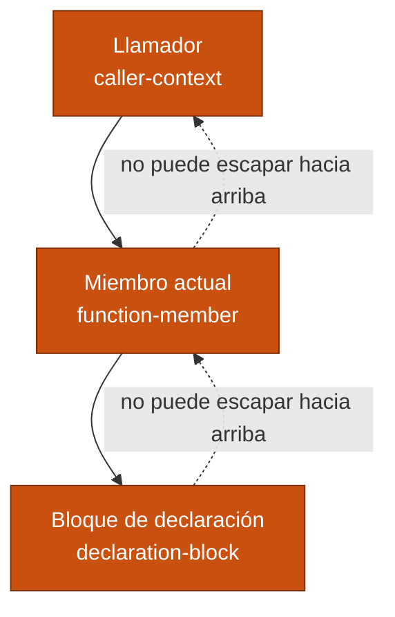

<div align="center">

# 15 · Bajo el capó y rendimiento

**Qué genera el compilador, qué cuesta cada abstracción y cómo medir antes de optimizar**

[⬅ 14 · Hilos evolutivos](14-hilos-evolutivos.md) · [🏠 Índice](../README.md) · [16 · Guías de decisión ➡](16-guias-de-decision.md)

</div>

---

## Contenido

1. [La traducción a un C# más simple](#1-la-traducción-a-un-c-más-simple)
2. [Mapa de costos](#2-mapa-de-costos)
3. [`class`, `struct` y `ref struct`](#3-class-struct-y-ref-struct)
4. [Clausuras](#4-clausuras)
5. [Reglas de seguridad de referencias](#5-reglas-de-seguridad-de-referencias)
6. [Native AOT y recorte](#6-native-aot-y-recorte)
7. [Medir con BenchmarkDotNet](#7-medir-con-benchmarkdotnet)
8. [Caso real: la multiplicación de matrices de este repositorio](#8-caso-real-la-multiplicación-de-matrices-de-este-repositorio)
9. [Referencias](#9-referencias)

---

## 1. La traducción a un C# más simple

El compilador convierte buena parte del lenguaje en construcciones más simples antes de emitir IL (*lowering*). Conocer la traducción explica el comportamiento y el costo.

| Escribes | El compilador produce | Lo que debes recordar |
|---|---|---|
| `foreach` sobre arreglo | Bucle `for` con índice | Sin enumerador |
| `foreach` sobre `List<T>` | `struct` `Enumerator` con `try/finally` | Sin asignación, salvo a través de `IEnumerable<T>` |
| `using` | `try/finally` | |
| `lock (obj)` | `Monitor.Enter` / `Exit` | Con `Lock`: `EnterScope()` |
| Iterador `yield` | Clase con estado | Una asignación por enumeración |
| `async` | `struct` de estado + *builder* | Pasa al *heap* si se suspende |
| Lambda sin captura | Delegado en caché | Una sola asignación |
| Lambda con captura | Clase generada + delegado | Asignación por ámbito |
| `record` | Clase y sus miembros | Igualdad generada |
| `$"…"` | `DefaultInterpolatedStringHandler` | Sin *boxing* desde C# 10 |
| `[1, 2, 3]` | Depende del destino | [Tabla de C# 12](11-csharp-12-13-colecciones.md#2-c-12-expresiones-de-colección) |
| `x is > 0 and < 5` | Comparaciones directas | Sin costo adicional |
| `switch` sobre cadenas | Hash o comparación por longitud y caracteres | Decisión del compilador |
| `union` | `struct` con `object?` | *Boxing* de tipos de valor |

Para ver la traducción real, usa [SharpLab](https://sharplab.io/), o `ildasm` e ILSpy sobre tu ensamblado.

---

## 2. Mapa de costos

| Operación | Asignación | Comentario |
|---|---|---|
| Convertir `int` a `object` | ✅ | *Boxing* |
| Convertir un `struct` a una interfaz | ✅ | Salvo a través de una restricción genérica |
| Llamada genérica con `T : struct` | ❌ | Especializada por el JIT |
| Tupla (`ValueTuple`) | ❌ | Tipo de valor |
| `record class` | ✅ | Clase normal |
| `record struct` | ❌ | Tipo de valor |
| `Span<T>` | ❌ | `ref struct` |
| `Substring`, `a[1..3]` en arreglo | ✅ | Copia |
| `AsSpan()[1..3]` | ❌ | Vista |
| `params T[]` | ✅ | Un arreglo por llamada, salvo con cero argumentos |
| `params ReadOnlySpan<T>` | ❌ normalmente | |
| Iterador `yield` | ✅ | |
| LINQ encadenado | ✅ | Iterador y delegado por operador |
| `Task` ya completada | Depende | Hay cachés para algunos valores |
| `ValueTask` completada de forma síncrona | ❌ | |

```csharp cs=14 run
long antes = GC.GetAllocatedBytesForCurrentThread();
int[] datos = new int[1000];
long despues = GC.GetAllocatedBytesForCurrentThread();
Console.WriteLine(despues - antes >= 4000);        // → True

antes = GC.GetAllocatedBytesForCurrentThread();
ReadOnlySpan<int> vista = datos.AsSpan(10, 500);   // sin asignación
int total = vista.Length;
despues = GC.GetAllocatedBytesForCurrentThread();
Console.WriteLine(despues - antes);                // → 0
```

---

## 3. `class`, `struct` y `ref struct`

| Criterio | `class` | `struct` | `ref struct` |
|---|---|---|---|
| Vive en | *Heap* | Según su contenedor | **Solo** en la pila |
| Copia al asignar | Referencia | Todo el valor | Todo el valor |
| Se puede guardar en un campo de clase | ✅ | ✅ | ❌ |
| Cruza un `await` | ✅ | ✅ | ❌ |
| Ideal para | Identidad y comportamiento | Valores pequeños e inmutables | Vistas de memoria |

**Reglas para `struct`:**

1. Hazlo `readonly` siempre que puedas.
2. Mantenlo pequeño: la copia crece con el tamaño. Una guía habitual lo sitúa en torno a 16 *bytes*; mide en tu caso.
3. Si guardas uno en una colección con búsquedas, implementa `IEquatable<T>`: el `Equals` por defecto de `ValueType` puede usar reflexión.
4. Evita convertirlo a una interfaz: usa una restricción genérica.

```csharp cs=10 run
var lento = new Lento(1);
var rapido = new Rapido(1);
Console.WriteLine(lento.Equals(new Lento(1)));    // → True
Console.WriteLine(rapido.Equals(new Rapido(1)));  // → True

struct Lento                                 // ValueType.Equals: sin igualdad generada
{
    public int X;
    public Lento(int x) => X = x;
}

readonly record struct Rapido(int X);        // IEquatable<T> generado
```

---

## 4. Clausuras

```csharp cs=9 run
var lista = new List<int> { 1, 2, 3 };
int limite = 1;

// Captura `limite`: asigna una clase generada y un delegado
Console.WriteLine(lista.Count(x => x > limite));         // → 2

// Sin captura: el delegado queda en caché
Console.WriteLine(lista.Count(static x => x > 1));       // → 2
```

```csharp cs=9 err=CS8820
int limite = 1;
Func<int, bool> f = static x => x > limite;   // error CS8820: una lambda static no captura
```

Con `static`, **el compilador convierte un costo oculto en un error visible**.

---

## 5. Reglas de seguridad de referencias

El compilador asigna a cada referencia un **ámbito seguro**: el más amplio al que puede escapar. Un valor no puede salir de su ámbito.



```csharp cs=11 err=CS8352
static Span<int> Malo()
{
    Span<int> local = stackalloc int[4];
    return local;    // error CS8352: la pila desaparece al volver
}
```

```csharp cs=11 unsafe err=CS8168
static ref int Peor()
{
    int x = 1;
    return ref x;   // error CS8168: x no sobrevive al método
}
```

| Herramienta | Efecto |
|---|---|
| `scoped` | Reduce el ámbito: promete que la referencia no escapa |
| `[UnscopedRef]` | Lo amplía, para devolver una referencia a un campo propio |
| `readonly` | Evita copias defensivas |
| `allows ref struct` | Propaga las reglas a un genérico |

---

## 6. Native AOT y recorte

Native AOT compila a código nativo: arranque rápido y sin JIT, a cambio de restricciones que condicionan el estilo del código.

| Característica | Native AOT | Alternativa |
|---|---|---|
| Generadores de código | ✅ Ideal | — |
| `dynamic` | ⚠️ Depende de reflexión | Tipos concretos |
| Reflexión sobre tipos no referenciados | ❌ Se recortan | Generadores, `[DynamicallyAccessedMembers]` |
| `Assembly.LoadFrom`, `Reflection.Emit` | ❌ | Compilación anticipada |
| `System.Text.Json` con reflexión | ⚠️ | `JsonSerializerContext` |
| `Regex` interpretado | ✅ con costo | `[GeneratedRegex]` |
| Aplicaciones de un archivo | ✅ Por defecto al publicar | `#:property PublishAot=false` |

---

## 7. Medir con BenchmarkDotNet

No optimices por intuición. El JIT especializa, hace *inlining*, elimina comprobaciones de límites y usa compilación por niveles, así que `Stopwatch` en un bucle da conclusiones erróneas.

| Práctica | Motivo |
|---|---|
| Compila en **Release** | Debug desactiva optimizaciones |
| Usa `[MemoryDiagnoser]` | La asignación suele importar más que la CPU |
| Devuelve el resultado | Si no, el JIT puede eliminar el trabajo |
| Compara con `[Benchmark(Baseline = true)]` | Lo relevante es la relación |
| Prueba tamaños realistas | El comportamiento cambia con la caché |

---

## 8. Caso real: la multiplicación de matrices de este repositorio

El código de la raíz de este repositorio multiplica matrices genéricas de forma concurrente, y reúne características de varias décadas:

| Elemento del código | Archivo | Característica | Versión |
|---|---|---|---|
| `Matrix<T> where T : unmanaged, INumber<T>` | [`Matrix.cs`](../Matrix.cs) | Matemática genérica + restricción `unmanaged` | C# 11 + 7.3 |
| `ReadOnlySpan<T>` en `FromRowMajor` | [`Matrix.cs`](../Matrix.cs) | `Span<T>` | C# 7.2 |
| `async Task<Matrix<T>> MulConcurrent` | [`MatrixMultiply.cs`](../MatrixMultiply.cs) | `async`/`await` | C# 5 |
| `readonly record struct RowBlock` | [`MulConcurrent.cs`](../MulConcurrent.cs) | `record struct` | C# 10 |
| `Channel.CreateBounded<RowBlock>` | [`MatrixMultiply.cs`](../MatrixMultiply.cs) | Grupo de trabajadores productor/consumidor | Biblioteca |
| `init` en `MulOptions` | [`MulOptions.cs`](../MulOptions.cs) | Propiedades `init` | C# 9 |
| `params Action<MulOptionsBuilder>[]` | [`MatrixMultiply.cs`](../MatrixMultiply.cs) | Patrón de opciones funcionales | C# 3 + 1 |

Dos decisiones de rendimiento destacables: el almacenamiento es un **arreglo plano en orden de filas**, y `B` se **transpone** para que el bucle interno lea memoria contigua y aproveche la caché.

Resultado registrado en [`BenchmarkDotNet.Artifacts`](../BenchmarkDotNet.Artifacts/results/MatrixBenchmarks-report-github.md):

| Método | Media | Desviación | Asignado | Entorno |
|---|---:|---:|---:|---|
| `MulConcurrent_512` | **66,64 ms** | 2,064 ms | 4 MB | Intel Core i5-8300H, 8 hilos lógicos, Windows 11, .NET 10.0.0 |

Los 4 MB son coherentes con los datos: dos matrices de 512×512 de `double` ocupan 2 MB cada una, una para el resultado y otra para `B` transpuesta.

> [!NOTE]
> Estas cifras son una medición histórica del repositorio y no se repitieron para este atlas: el proyecto no compila en su estado actual. Consulta
> [19 § Estado del código](19-referencia-rapida-y-glosario.md#6-el-código-de-este-repositorio).

---

## 9. Referencias

- [Performance in C#](https://learn.microsoft.com/dotnet/csharp/advanced-topics/performance/) · [Memory-related and span types](https://learn.microsoft.com/dotnet/standard/memory-and-spans/)
- [Native AOT deployment](https://learn.microsoft.com/dotnet/core/deploying/native-aot/) · [BenchmarkDotNet](https://benchmarkdotnet.org/)
- [Ref safety](https://learn.microsoft.com/dotnet/csharp/language-reference/keywords/ref)
