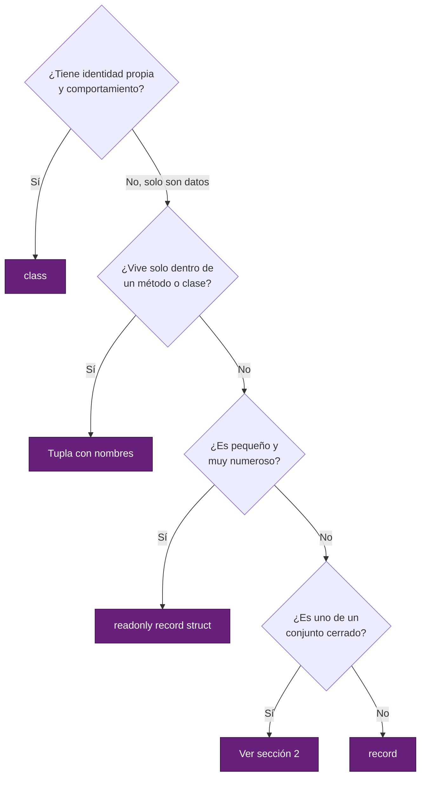
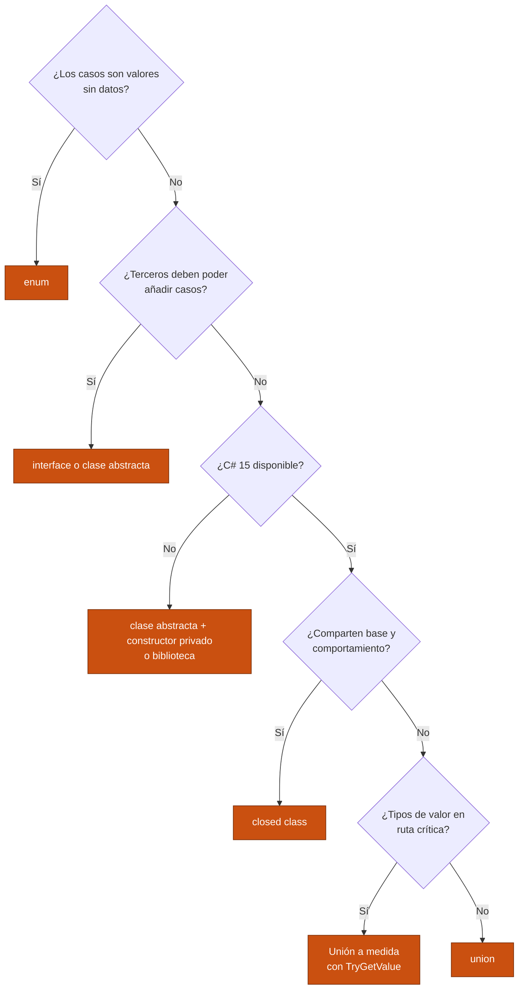
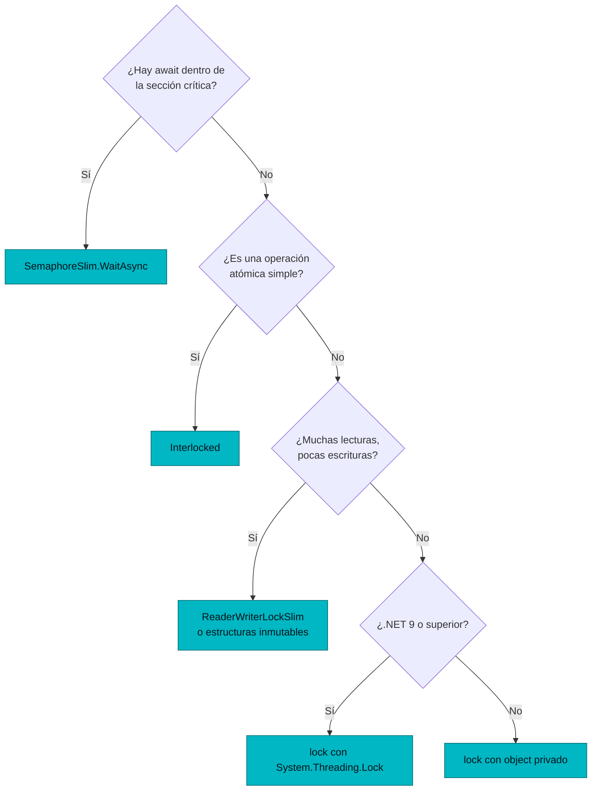
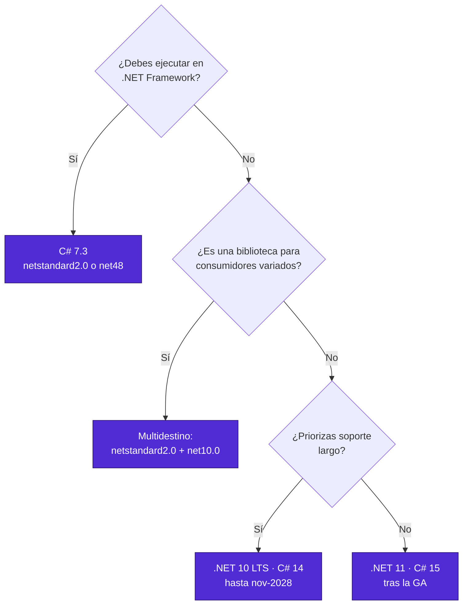

<div align="center">

# 16 · Guías de decisión

**Árboles para elegir la construcción correcta del lenguaje en cada situación**

[⬅ 15 · Bajo el capó](15-bajo-el-capo-y-rendimiento.md) · [🏠 Índice](../README.md) · [17 · Catálogo A–Z ➡](17-catalogo-a-z.md)

</div>

> [!TIP]
> Los árboles son puntos de partida: la decisión final depende de tu base de código, tu equipo y de mediciones reales.

---

## Contenido

1. [Modelar datos](#1-modelar-datos)
2. [Representar "uno de varios"](#2-representar-uno-de-varios)
3. [Tratar errores](#3-tratar-errores)
4. [Elegir una colección](#4-elegir-una-colección)
5. [Concurrencia y sincronización](#5-concurrencia-y-sincronización)
6. [Asincronía: qué tipo devolver](#6-asincronía-qué-tipo-devolver)
7. [Extender un tipo](#7-extender-un-tipo)
8. [Elegir versión de C# y TFM](#8-elegir-versión-de-c-y-tfm)
9. [Decisiones que conviene evitar](#9-decisiones-que-conviene-evitar)

---

## 1. Modelar datos



| Necesidad | Elección | Versión mínima |
|---|---|---|
| Entidad de EF Core con seguimiento | `class` | C# 1 |
| DTO, evento, comando | `record` | C# 9 |
| Objeto de valor (dinero, coordenada) | `readonly record struct` | C# 10 |
| Resultado interno con dos valores | Tupla | C# 7 |
| Propiedades obligatorias en inicializadores | `required` | C# 11 |
| Inyección de dependencias | Constructor primario | C# 12 |

---

## 2. Representar "uno de varios"



---

## 3. Tratar errores

| Situación | Elección |
|---|---|
| Fallo inesperado o error de programación | Excepción |
| Argumento inválido | `ArgumentException` y sus métodos `ThrowIf…` |
| Fallo **esperado**, frecuente y parte del dominio | Patrón `TryX` o unión `Resultado` |
| Ruta crítica | Evita excepciones: son costosas |
| Reintento según datos del error | Filtro `when` |
| Limpieza | `using`, nunca un `catch` que solo relanza |

```csharp cs=15 run
Console.WriteLine(Mensaje(Parsear("7")));    // → valor 7
Console.WriteLine(Mensaje(Parsear("x")));    // → no numérico

static Lectura Parsear(string s) =>
    int.TryParse(s, out int n) ? new Valido(n) : new Invalido("no numérico");

static string Mensaje(Lectura l) => l switch
{
    Valido v => $"valor {v.Numero}",
    Invalido i => i.Motivo,
    null => "sin lectura",
};

record Valido(int Numero);
record Invalido(string Motivo);
union Lectura(Valido, Invalido);
```

---

## 4. Elegir una colección

| Necesidad | Tipo | Nota |
|---|---|---|
| Secuencia general | `List<T>` | La opción por defecto |
| Búsqueda por clave | `Dictionary<TKey, TValue>` | |
| Pertenencia | `HashSet<T>` | |
| Orden por clave | `SortedDictionary<,>` | |
| Fijo, inmutable, muchas lecturas | `FrozenDictionary<,>`, `FrozenSet<T>` | Construcción más cara, lectura más rápida |
| Inmutable con versiones | `ImmutableList<T>`, `ImmutableArray<T>` | |
| Varios hilos | `ConcurrentDictionary<,>` | |
| Productor/consumidor | `Channel<T>` | Usado en este repositorio |
| Prioridades | `PriorityQueue<,>` | |
| API de entrada | `IEnumerable<T>`, `IReadOnlyList<T>` | Exige lo mínimo |
| API de salida | `IReadOnlyList<T>` o el tipo concreto | Promete lo máximo |

---

## 5. Concurrencia y sincronización



| Trabajo | Herramienta |
|---|---|
| E/S concurrente | `Task.WhenAll` |
| CPU por elementos | `Parallel.ForEach`, `Parallel.ForEachAsync` |
| Tubería con contrapresión | `Channel<T>` acotado |
| Limitar la concurrencia | `SemaphoreSlim`, `MaxDegreeOfParallelism` |

---

## 6. Asincronía: qué tipo devolver

| Situación | Tipo |
|---|---|
| Opción por defecto | `Task` / `Task<T>` |
| Ruta crítica que suele completar de forma síncrona | `ValueTask<T>` |
| Muchos elementos que llegan con el tiempo | `IAsyncEnumerable<T>` |
| Manejador de evento | `async void` (único caso) |
| El resultado ya existe | `Task.FromResult`, sin `async` |

---

## 7. Extender un tipo

| Situación | Opción | Versión |
|---|---|---|
| El tipo es tuyo | Añade un miembro | C# 1 |
| Necesitas estado | Composición o herencia | C# 1 |
| Evolucionar una interfaz publicada | Miembro por defecto | C# 8 |
| Tipo ajeno, solo métodos | Método de extensión `this` | C# 3 |
| Tipo ajeno, propiedades, estáticos u operadores | Bloque `extension` | C# 14 |
| Tipo ajeno, indexador | Bloque `extension` | C# 15 |

---

## 8. Elegir versión de C# y TFM



---

## 9. Decisiones que conviene evitar

| Antipatrón | Por qué | Alternativa |
|---|---|---|
| `LangVersion=latest` | No reproducible | Omitir o fijar |
| C# más nuevo que el TFM | Sin soporte | Sube el TFM |
| `.Result` y `.Wait()` en código asíncrono | Interbloqueos | `await` |
| `async void` en lógica | Excepciones que no se pueden capturar | `async Task` |
| `dynamic` por comodidad | Sin comprobación | Tipos concretos |
| `!` por todo el código | Promesas sin validar | Modela el `null` |
| `record` con colecciones mutables | Igualdad y copia engañosas | Colecciones inmutables |
| `struct` grande y mutable | Copias y errores sutiles | `class` o `readonly struct` |
| `_` en un `switch` sobre una unión | Oculta casos nuevos | Brazo `null` y cobertura explícita |
| `ToList()` antes de `Where` en EF Core | Trae toda la tabla | Filtra en `IQueryable<T>` |
| Interpolar SQL | Inyección de SQL | Parámetros |
| Capturar `Exception` sin relanzar | Oculta errores | Captura lo que puedes tratar |
