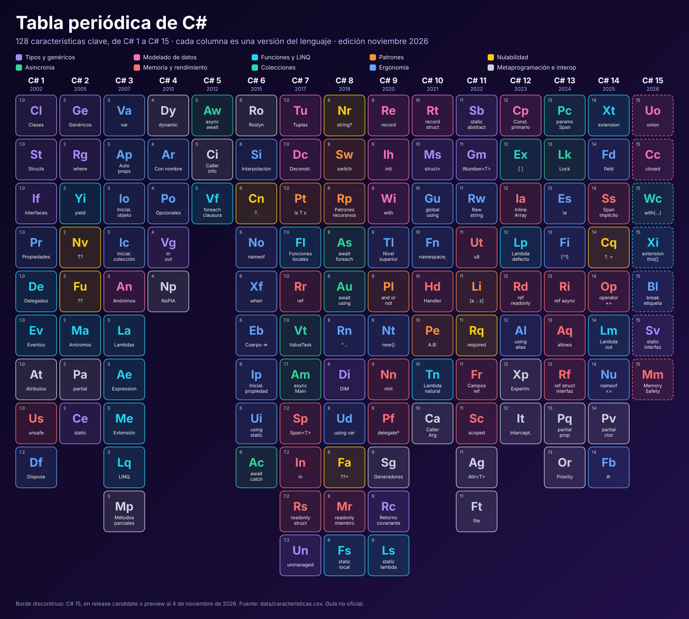

# 17 · Catálogo A–Z de características de C#

**154 características con su versión, familia, requisito y capítulo · edición noviembre 2026**

[⬅ 16 · Guías de decisión](16-guias-de-decision.md) · [🏠 Índice](../README.md) · [18 · Migración ➡](18-migracion-y-ciclo-de-vida.md)

> [!NOTE]
> Este archivo se **genera automáticamente** desde [`data/caracteristicas.csv`](../data/caracteristicas.csv) con
> `python3 tools/generar_atlas.py`. Para corregir o añadir una característica, edita el CSV y ejecuta el script.

## Resumen por versión

| Versión | Año | Características | Compilador | Biblioteca | Runtime |
|---|---|---:|---:|---:|---:|
| [C# 1.0](02-csharp-1-cimientos.md) | 2002 | 12 | 12 | 0 | 0 |
| [C# 1.2](02-csharp-1-cimientos.md) | 2003 | 1 | 1 | 0 | 0 |
| [C# 2](03-csharp-2-genericos.md) | 2005 | 10 | 8 | 1 | 1 |
| [C# 3](04-csharp-3-linq.md) | 2007 | 10 | 9 | 1 | 0 |
| [C# 4](05-csharp-4-5-dinamismo-y-asincronia.md) | 2010 | 5 | 3 | 1 | 1 |
| [C# 5](05-csharp-4-5-dinamismo-y-asincronia.md) | 2012 | 3 | 2 | 1 | 0 |
| [C# 6](06-csharp-6-roslyn.md) | 2015 | 10 | 10 | 0 | 0 |
| [C# 7.0](07-csharp-7-tuplas-patrones-y-ref.md) | 2017 | 10 | 8 | 2 | 0 |
| [C# 7.1](07-csharp-7-tuplas-patrones-y-ref.md) | 2017 | 3 | 3 | 0 | 0 |
| [C# 7.2](07-csharp-7-tuplas-patrones-y-ref.md) | 2017 | 5 | 4 | 1 | 0 |
| [C# 7.3](07-csharp-7-tuplas-patrones-y-ref.md) | 2018 | 4 | 4 | 0 | 0 |
| [C# 8](08-csharp-8-nulabilidad-y-streams.md) | 2019 | 11 | 8 | 2 | 1 |
| [C# 9](09-csharp-9-10-records.md) | 2020 | 14 | 11 | 1 | 2 |
| [C# 10](09-csharp-9-10-records.md) | 2021 | 9 | 8 | 1 | 0 |
| [C# 11](10-csharp-11-matematica-generica.md) | 2022 | 14 | 10 | 2 | 2 |
| [C# 12](11-csharp-12-13-colecciones.md) | 2023 | 8 | 6 | 1 | 1 |
| [C# 13](11-csharp-12-13-colecciones.md) | 2024 | 9 | 6 | 2 | 1 |
| [C# 14](12-csharp-14-extensiones.md) | 2025 | 9 | 9 | 0 | 0 |
| [C# 15](13-csharp-15-uniones.md) | 2026 | 7 | 6 | 1 | 0 |
| **Total** | | **154** | **128** | **17** | **9** |

## Resumen por familia

| Familia | Características |
|---|---:|
| Tipos y genéricos | 18 |
| Modelado de datos | 12 |
| Funciones y LINQ | 18 |
| Patrones | 6 |
| Nulabilidad | 8 |
| Asincronía | 7 |
| Memoria y rendimiento | 23 |
| Colecciones | 3 |
| Ergonomía | 41 |
| Metaprogramación e interop | 18 |

**Leyenda.** Estado: 🟢 estable · 🟡 RC *release candidate* · 🟣 *preview*. Requisito: lo que exige por debajo del compilador; consulta [01 § Qué necesita cada característica](01-modelo-de-versiones.md#3-qué-necesita-cada-característica).

## Catálogo

### A

| Característica | C# | Familia | Requisito | Estado | Descripción |
|---|---|---|---|---|---|
| Accesibilidad por accesor | [2](03-csharp-2-genericos.md) | Ergonomía | Compilador | 🟢 | Modificadores distintos en get y set |
| Alias de cualquier tipo | [12](11-csharp-12-13-colecciones.md) | Ergonomía | Compilador | 🟢 | using P = (int int); |
| allows ref struct | [13](11-csharp-12-13-colecciones.md) | Memoria y rendimiento | Runtime | 🟢 | Antirrestricción genérica |
| Árboles de expresión | [3](04-csharp-3-linq.md) | Funciones y LINQ | Biblioteca | 🟢 | Código representado como datos |
| Argumentos con nombre | [4](05-csharp-4-5-dinamismo-y-asincronia.md) | Ergonomía | Compilador | 🟢 | M(puerto: 80) |
| Argumentos con nombre no finales | [7.2](07-csharp-7-tuplas-patrones-y-ref.md) | Ergonomía | Compilador | 🟢 | M(a: 1 2) |
| Argumentos de colección | [15](13-csharp-15-uniones.md) | Colecciones | Compilador | 🟡 RC | [with(…) …] |
| Arreglos en línea | [12](11-csharp-12-13-colecciones.md) | Memoria y rendimiento | Runtime | 🟢 | InlineArray |
| Asignación condicional nula | [14](12-csharp-14-extensiones.md) | Nulabilidad | Compilador | 🟢 | a?.b = c |
| Asignación de fusión nula | [8](08-csharp-8-nulabilidad-y-streams.md) | Nulabilidad | Compilador | 🟢 | a ??= b |
| async Main | [7.1](07-csharp-7-tuplas-patrones-y-ref.md) | Asincronía | Compilador | 🟢 | Punto de entrada asíncrono |
| async y await | [5](05-csharp-4-5-dinamismo-y-asincronia.md) | Asincronía | Biblioteca | 🟢 | Máquina de estados sobre Task |
| Atributo Experimental | [12](11-csharp-12-13-colecciones.md) | Metaprogramación e interop | Biblioteca | 🟢 | Marca API experimentales |
| Atributos | [1.0](02-csharp-1-cimientos.md) | Metaprogramación e interop | Compilador | 🟢 | Metadatos declarativos en el ensamblado |
| Atributos genéricos | [11](10-csharp-11-matematica-generica.md) | Metaprogramación e interop | Compilador | 🟢 | [Attr<T>] |
| await en catch y finally | [6](06-csharp-6-roslyn.md) | Asincronía | Compilador | 🟢 | await donde antes no se permitía |
| await using | [8](08-csharp-8-nulabilidad-y-streams.md) | Asincronía | Compilador | 🟢 | IAsyncDisposable |

### B

| Característica | C# | Familia | Requisito | Estado | Descripción |
|---|---|---|---|---|---|
| break y continue con etiqueta | [15](13-csharp-15-uniones.md) | Ergonomía | Compilador | 🟡 RC | break externo; |

### C

| Característica | C# | Familia | Requisito | Estado | Descripción |
|---|---|---|---|---|---|
| Cadenas sin formato | [11](10-csharp-11-matematica-generica.md) | Ergonomía | Compilador | 🟢 | Triple comilla y $$ |
| CallerArgumentExpression | [10](09-csharp-9-10-records.md) | Metaprogramación e interop | Compilador | 🟢 | Texto del argumento |
| Campos ref | [11](10-csharp-11-matematica-generica.md) | Memoria y rendimiento | Runtime | 🟢 | Referencias dentro de ref struct |
| Clases estáticas | [2](03-csharp-2-genericos.md) | Tipos y genéricos | Compilador | 🟢 | Sin instancias ni herencia |
| Clases y herencia simple | [1.0](02-csharp-1-cimientos.md) | Tipos y genéricos | Compilador | 🟢 | Tipos de referencia, herencia simple y virtual explícito |
| Código unsafe y punteros | [1.0](02-csharp-1-cimientos.md) | Memoria y rendimiento | Compilador | 🟢 | Punteros y stackalloc bajo decisión explícita |
| Colecciones params | [13](11-csharp-12-13-colecciones.md) | Colecciones | Compilador | 🟢 | params Span y otras colecciones |
| Compilador Roslyn | [6](06-csharp-6-roslyn.md) | Metaprogramación e interop | Compilador | 🟢 | Compilador escrito en C# y expuesto como API |
| const interpolado | [10](09-csharp-9-10-records.md) | Ergonomía | Compilador | 🟢 | Constantes con interpolación |
| Constructores primarios | [12](11-csharp-12-13-colecciones.md) | Modelado de datos | Compilador | 🟢 | class C(int x) |
| Constructores y eventos parciales | [14](12-csharp-14-extensiones.md) | Metaprogramación e interop | Compilador | 🟢 | Completa la serie de partial |
| Conversiones implícitas de Span | [14](12-csharp-14-extensiones.md) | Memoria y rendimiento | Compilador | 🟢 | Soporte de primera clase |

### D

| Característica | C# | Familia | Requisito | Estado | Descripción |
|---|---|---|---|---|---|
| Declaraciones using | [8](08-csharp-8-nulabilidad-y-streams.md) | Ergonomía | Compilador | 🟢 | using var x = …; |
| Deconstrucción | [7.0](07-csharp-7-tuplas-patrones-y-ref.md) | Modelado de datos | Compilador | 🟢 | var (a b) = x |
| Delegados | [1.0](02-csharp-1-cimientos.md) | Funciones y LINQ | Compilador | 🟢 | Referencias a métodos seguras y multidifusión |
| Descartes | [7.0](07-csharp-7-tuplas-patrones-y-ref.md) | Ergonomía | Compilador | 🟢 | _ ignora un valor |
| Desplazamiento sin signo | [11](10-csharp-11-matematica-generica.md) | Ergonomía | Compilador | 🟢 | >>> |
| Directivas de apps de un archivo | [14](12-csharp-14-extensiones.md) | Ergonomía | Compilador | 🟢 | #:package, #:property y dotnet run app.cs |
| Dispose en foreach | [1.2](02-csharp-1-cimientos.md) | Ergonomía | Compilador | 🟢 | foreach llama a Dispose sobre el enumerador |
| dynamic | [4](05-csharp-4-5-dinamismo-y-asincronia.md) | Metaprogramación e interop | Biblioteca | 🟢 | Enlace en ejecución con el DLR |

### E

| Característica | C# | Familia | Requisito | Estado | Descripción |
|---|---|---|---|---|---|
| Enteros nativos | [9](09-csharp-9-10-records.md) | Memoria y rendimiento | Compilador | 🟢 | nint y nuint |
| Enumeraciones | [1.0](02-csharp-1-cimientos.md) | Tipos y genéricos | Compilador | 🟢 | Conjuntos de constantes con nombre |
| Espacio de nombres de archivo | [10](09-csharp-9-10-records.md) | Ergonomía | Compilador | 🟢 | namespace X; |
| Estáticos de interfaz en runtimes antiguos | [15](13-csharp-15-uniones.md) | Tipos y genéricos | Compilador | 🟡 RC | Sin soporte de DIM |
| Eventos | [1.0](02-csharp-1-cimientos.md) | Funciones y LINQ | Compilador | 🟢 | Publicación y suscripción protegidas |
| Expresiones de colección | [12](11-csharp-12-13-colecciones.md) | Colecciones | Compilador | 🟢 | [1 2 .. otra] |
| Expresiones de consulta | [3](04-csharp-3-linq.md) | Funciones y LINQ | Compilador | 🟢 | from where select |
| Expresiones lambda | [3](04-csharp-3-linq.md) | Funciones y LINQ | Compilador | 🟢 | x => x + 1 |
| Expresiones switch | [8](08-csharp-8-nulabilidad-y-streams.md) | Patrones | Compilador | 🟢 | x switch { } |
| Expresiones throw | [7.0](07-csharp-7-tuplas-patrones-y-ref.md) | Nulabilidad | Compilador | 🟢 | x ?? throw |
| Expresiones with | [9](09-csharp-9-10-records.md) | Modelado de datos | Compilador | 🟢 | Copia no destructiva |

### F

| Característica | C# | Familia | Requisito | Estado | Descripción |
|---|---|---|---|---|---|
| field | [14](12-csharp-14-extensiones.md) | Ergonomía | Compilador | 🟢 | Campo sintetizado de una propiedad |
| Filtros de excepción | [6](06-csharp-6-roslyn.md) | Ergonomía | Compilador | 🟢 | catch when sin desenrollar la pila |
| Flujos asíncronos | [8](08-csharp-8-nulabilidad-y-streams.md) | Asincronía | Biblioteca | 🟢 | IAsyncEnumerable<T> y await foreach |
| foreach | [1.0](02-csharp-1-cimientos.md) | Ergonomía | Compilador | 🟢 | Recorrido por patrón GetEnumerator |
| Funciones locales | [7.0](07-csharp-7-tuplas-patrones-y-ref.md) | Funciones y LINQ | Compilador | 🟢 | Funciones dentro de métodos |
| Funciones locales estáticas | [8](08-csharp-8-nulabilidad-y-streams.md) | Funciones y LINQ | Compilador | 🟢 | Sin capturas |

### G

| Característica | C# | Familia | Requisito | Estado | Descripción |
|---|---|---|---|---|---|
| Generadores de código | [9](09-csharp-9-10-records.md) | Metaprogramación e interop | Compilador | 🟢 | Añaden código durante la compilación |
| Genéricos | [2](03-csharp-2-genericos.md) | Tipos y genéricos | Runtime | 🟢 | Tipos y métodos parametrizados y reificados en el CLR |
| global using | [10](09-csharp-9-10-records.md) | Ergonomía | Compilador | 🟢 | Importación para todo el proyecto |

### I

| Característica | C# | Familia | Requisito | Estado | Descripción |
|---|---|---|---|---|---|
| Igualdad de tuplas | [7.3](07-csharp-7-tuplas-patrones-y-ref.md) | Modelado de datos | Compilador | 🟢 | == elemento a elemento |
| Indexadores | [1.0](02-csharp-1-cimientos.md) | Ergonomía | Compilador | 🟢 | Acceso por índice sobre objetos |
| Indexadores de extensión | [15](13-csharp-15-uniones.md) | Funciones y LINQ | Compilador | 🟡 RC | this[…] en extension |
| Índice desde el final en inicializadores | [13](11-csharp-12-13-colecciones.md) | Ergonomía | Compilador | 🟢 | [^1] = 0 |
| Índices y rangos | [8](08-csharp-8-nulabilidad-y-streams.md) | Ergonomía | Biblioteca | 🟢 | ^1 y a..b |
| Información del llamador | [5](05-csharp-4-5-dinamismo-y-asincronia.md) | Metaprogramación e interop | Compilador | 🟢 | CallerMemberName y compañía |
| Inicializadores de colección | [3](04-csharp-3-linq.md) | Ergonomía | Compilador | 🟢 | new List<int> { 1 } |
| Inicializadores de índice | [6](06-csharp-6-roslyn.md) | Ergonomía | Compilador | 🟢 | ["a"] = 1 |
| Inicializadores de módulo | [9](09-csharp-9-10-records.md) | Metaprogramación e interop | Compilador | 🟢 | Código al cargar el ensamblado |
| Inicializadores de objeto | [3](04-csharp-3-linq.md) | Ergonomía | Compilador | 🟢 | new T { A = 1 } |
| Inicializadores de propiedad | [6](06-csharp-6-roslyn.md) | Ergonomía | Compilador | 🟢 | { get; } = valor |
| Inicializadores de stackalloc | [7.3](07-csharp-7-tuplas-patrones-y-ref.md) | Memoria y rendimiento | Compilador | 🟢 | stackalloc[] { 1 2 } |
| init | [9](09-csharp-9-10-records.md) | Modelado de datos | Biblioteca | 🟢 | Propiedades de solo inicialización |
| Instrucciones de nivel superior | [9](09-csharp-9-10-records.md) | Ergonomía | Compilador | 🟢 | Programas sin Main |
| Interceptores | [12](11-csharp-12-13-colecciones.md) | Metaprogramación e interop | Compilador | 🟢 | Sustituyen llamadas en compilación; estables desde el SDK 9.0.2xx |
| Interfaces | [1.0](02-csharp-1-cimientos.md) | Tipos y genéricos | Compilador | 🟢 | Contratos con implementación múltiple |
| Interpolación de cadenas | [6](06-csharp-6-roslyn.md) | Ergonomía | Compilador | 🟢 | $"{x}" |
| Iteradores | [2](03-csharp-2-genericos.md) | Funciones y LINQ | Compilador | 🟢 | yield return genera una máquina de estados |

### J

| Característica | C# | Familia | Requisito | Estado | Descripción |
|---|---|---|---|---|---|
| Jerarquías cerradas | [15](13-csharp-15-uniones.md) | Modelado de datos | Compilador | 🟡 RC | closed class |

### L

| Característica | C# | Familia | Requisito | Estado | Descripción |
|---|---|---|---|---|---|
| Lambdas estáticas | [9](09-csharp-9-10-records.md) | Funciones y LINQ | Compilador | 🟢 | Prohíben la captura |
| Literal default | [7.1](07-csharp-7-tuplas-patrones-y-ref.md) | Ergonomía | Compilador | 🟢 | int n = default; |
| Literales binarios y separadores | [7.0](07-csharp-7-tuplas-patrones-y-ref.md) | Ergonomía | Compilador | 🟢 | 0b1010_1010 |
| Literales UTF-8 | [11](10-csharp-11-matematica-generica.md) | Memoria y rendimiento | Compilador | 🟢 | "x"u8 |

### M

| Característica | C# | Familia | Requisito | Estado | Descripción |
|---|---|---|---|---|---|
| Manejadores de interpolación | [10](09-csharp-9-10-records.md) | Memoria y rendimiento | Biblioteca | 🟢 | Interpolación sin cadenas temporales |
| Matemática genérica | [11](10-csharp-11-matematica-generica.md) | Tipos y genéricos | Biblioteca | 🟢 | INumber<T> y familia |
| Mejoras en struct | [10](09-csharp-9-10-records.md) | Tipos y genéricos | Compilador | 🟢 | Constructor sin parámetros e inicializadores |
| Métodos anónimos | [2](03-csharp-2-genericos.md) | Funciones y LINQ | Compilador | 🟢 | delegate { } con clausuras |
| Métodos de extensión | [3](04-csharp-3-linq.md) | Funciones y LINQ | Compilador | 🟢 | this en el primer parámetro |
| Métodos parciales | [3](04-csharp-3-linq.md) | Metaprogramación e interop | Compilador | 🟢 | Declaración e implementación separadas |
| Métodos parciales ampliados | [9](09-csharp-9-10-records.md) | Metaprogramación e interop | Compilador | 🟢 | Con accesibilidad y retorno |
| Miembros con cuerpo de expresión | [6](06-csharp-6-roslyn.md) | Ergonomía | Compilador | 🟢 | int X => 1; |
| Miembros de extensión | [14](12-csharp-14-extensiones.md) | Funciones y LINQ | Compilador | 🟢 | Bloques extension: propiedades, estáticos y operadores |
| Miembros de interfaz por defecto | [8](08-csharp-8-nulabilidad-y-streams.md) | Tipos y genéricos | Runtime | 🟢 | Interfaces con implementación |
| Miembros readonly | [8](08-csharp-8-nulabilidad-y-streams.md) | Memoria y rendimiento | Compilador | 🟢 | Evitan copias defensivas |
| Miembros static abstract | [11](10-csharp-11-matematica-generica.md) | Tipos y genéricos | Runtime | 🟢 | Polimorfismo estático en interfaces |
| Modificadores en lambdas simples | [14](12-csharp-14-extensiones.md) | Funciones y LINQ | Compilador | 🟢 | (a, out b) => … |

### N

| Característica | C# | Familia | Requisito | Estado | Descripción |
|---|---|---|---|---|---|
| nameof | [6](06-csharp-6-roslyn.md) | Ergonomía | Compilador | 🟢 | Nombre de un símbolo en compilación |
| nameof con genéricos sin enlazar | [14](12-csharp-14-extensiones.md) | Ergonomía | Compilador | 🟢 | nameof(List<>) |
| new con tipo de destino | [9](09-csharp-9-10-records.md) | Ergonomía | Compilador | 🟢 | List<int> a = new(); |
| Nombres de tupla inferidos | [7.1](07-csharp-7-tuplas-patrones-y-ref.md) | Modelado de datos | Compilador | 🟢 | Nombre tomado de la variable |

### O

| Característica | C# | Familia | Requisito | Estado | Descripción |
|---|---|---|---|---|---|
| Operador condicional nulo | [6](06-csharp-6-roslyn.md) | Nulabilidad | Compilador | 🟢 | a?.b y a?[i] |
| Operador de fusión nula | [2](03-csharp-2-genericos.md) | Nulabilidad | Compilador | 🟢 | a ?? b |
| Operadores checked definidos | [11](10-csharp-11-matematica-generica.md) | Tipos y genéricos | Compilador | 🟢 | operator checked |
| Operadores compuestos definidos | [14](12-csharp-14-extensiones.md) | Memoria y rendimiento | Compilador | 🟢 | operator += en instancia |
| OverloadResolutionPriority | [13](11-csharp-12-13-colecciones.md) | Metaprogramación e interop | Biblioteca | 🟢 | Orienta la resolución de sobrecargas |

### P

| Característica | C# | Familia | Requisito | Estado | Descripción |
|---|---|---|---|---|---|
| Parámetros in | [7.2](07-csharp-7-tuplas-patrones-y-ref.md) | Memoria y rendimiento | Compilador | 🟢 | Por referencia y de solo lectura |
| Parámetros opcionales | [4](05-csharp-4-5-dinamismo-y-asincronia.md) | Ergonomía | Compilador | 🟢 | Valores por defecto copiados en el llamador |
| Parámetros por defecto en lambdas | [12](11-csharp-12-13-colecciones.md) | Funciones y LINQ | Compilador | 🟢 | (int x = 1) => x |
| Patrones de lista | [11](10-csharp-11-matematica-generica.md) | Patrones | Compilador | 🟢 | [a .. z] |
| Patrones de propiedad extendidos | [10](09-csharp-9-10-records.md) | Patrones | Compilador | 🟢 | { A.B: 1 } |
| Patrones de tipo y constante | [7.0](07-csharp-7-tuplas-patrones-y-ref.md) | Patrones | Compilador | 🟢 | is T x y switch por tipo |
| Patrones recursivos | [8](08-csharp-8-nulabilidad-y-streams.md) | Patrones | Compilador | 🟢 | Propiedad, posicional y tupla |
| Patrones relacionales y lógicos | [9](09-csharp-9-10-records.md) | Patrones | Compilador | 🟢 | < > and or not |
| private protected | [7.2](07-csharp-7-tuplas-patrones-y-ref.md) | Tipos y genéricos | Compilador | 🟢 | Derivadas del mismo ensamblado |
| Propiedades | [1.0](02-csharp-1-cimientos.md) | Ergonomía | Compilador | 🟢 | get y set como concepto del lenguaje |
| Propiedades automáticas | [3](04-csharp-3-linq.md) | Ergonomía | Compilador | 🟢 | Campo oculto generado |
| Propiedades parciales | [13](11-csharp-12-13-colecciones.md) | Metaprogramación e interop | Compilador | 🟢 | Propiedades e indexadores parciales |
| Punteros a función | [9](09-csharp-9-10-records.md) | Memoria y rendimiento | Runtime | 🟢 | delegate* |

### R

| Característica | C# | Familia | Requisito | Estado | Descripción |
|---|---|---|---|---|---|
| readonly struct | [7.2](07-csharp-7-tuplas-patrones-y-ref.md) | Memoria y rendimiento | Compilador | 🟢 | Inmutabilidad garantizada |
| Reasignación de ref | [7.3](07-csharp-7-tuplas-patrones-y-ref.md) | Memoria y rendimiento | Compilador | 🟢 | r = ref otra |
| record | [9](09-csharp-9-10-records.md) | Modelado de datos | Compilador | 🟢 | Clases con igualdad por valor |
| record struct | [10](09-csharp-9-10-records.md) | Modelado de datos | Compilador | 🟢 | Registros como tipos de valor |
| ref en async e iteradores | [13](11-csharp-12-13-colecciones.md) | Memoria y rendimiento | Compilador | 🟢 | Sin cruzar await ni yield |
| ref locales y retornos | [7.0](07-csharp-7-tuplas-patrones-y-ref.md) | Memoria y rendimiento | Compilador | 🟢 | Referencias a ubicaciones |
| ref readonly parámetros | [12](11-csharp-12-13-colecciones.md) | Memoria y rendimiento | Compilador | 🟢 | Exige una variable |
| ref struct con interfaces | [13](11-csharp-12-13-colecciones.md) | Memoria y rendimiento | Compilador | 🟢 | Implementan sin convertirse |
| required | [11](10-csharp-11-matematica-generica.md) | Nulabilidad | Biblioteca | 🟢 | Propiedades obligatorias |
| Restricciones genéricas | [2](03-csharp-2-genericos.md) | Tipos y genéricos | Compilador | 🟢 | where T : class, struct, new() y herencia |
| Restricciones unmanaged Enum y Delegate | [7.3](07-csharp-7-tuplas-patrones-y-ref.md) | Tipos y genéricos | Compilador | 🟢 | Nuevas restricciones genéricas |
| Retornos async generalizados | [7.0](07-csharp-7-tuplas-patrones-y-ref.md) | Asincronía | Biblioteca | 🟢 | ValueTask<T> |
| Retornos covariantes | [9](09-csharp-9-10-records.md) | Tipos y genéricos | Runtime | 🟢 | override con un tipo más derivado |

### S

| Característica | C# | Familia | Requisito | Estado | Descripción |
|---|---|---|---|---|---|
| Saltos de línea en interpolación | [11](10-csharp-11-matematica-generica.md) | Ergonomía | Compilador | 🟢 | Expresiones en varias líneas |
| scoped | [11](10-csharp-11-matematica-generica.md) | Memoria y rendimiento | Compilador | 🟢 | La referencia no escapa |
| Secuencia de escape \e | [13](11-csharp-12-13-colecciones.md) | Ergonomía | Compilador | 🟢 | U+001B |
| Seguridad de memoria | [15](13-csharp-15-uniones.md) | Memoria y rendimiento | Compilador | 🟣 Preview | Nuevo modelo de unsafe |
| SkipLocalsInit | [9](09-csharp-9-10-records.md) | Memoria y rendimiento | Compilador | 🟢 | Omite poner a cero las variables locales |
| Span y ref struct | [7.2](07-csharp-7-tuplas-patrones-y-ref.md) | Memoria y rendimiento | Biblioteca | 🟢 | Vistas de memoria que viven en la pila |
| Structs | [1.0](02-csharp-1-cimientos.md) | Tipos y genéricos | Compilador | 🟢 | Tipos de valor con semántica de copia |
| Structs con valor por defecto automático | [11](10-csharp-11-matematica-generica.md) | Tipos y genéricos | Compilador | 🟢 | Pone a cero los campos sin asignar |
| System.Threading.Lock | [13](11-csharp-12-13-colecciones.md) | Asincronía | Biblioteca | 🟢 | lock con EnterScope |

### T

| Característica | C# | Familia | Requisito | Estado | Descripción |
|---|---|---|---|---|---|
| Tipo natural de lambdas | [10](09-csharp-9-10-records.md) | Funciones y LINQ | Compilador | 🟢 | var f = (int x) => x; |
| Tipos anónimos | [3](04-csharp-3-linq.md) | Modelado de datos | Compilador | 🟢 | Clases generadas con igualdad por valor |
| Tipos de interoperabilidad incrustados | [4](05-csharp-4-5-dinamismo-y-asincronia.md) | Metaprogramación e interop | Compilador | 🟢 | NoPIA para COM |
| Tipos de referencia anulables | [8](08-csharp-8-nulabilidad-y-streams.md) | Nulabilidad | Compilador | 🟢 | string? con análisis de flujo |
| Tipos de valor anulables | [2](03-csharp-2-genericos.md) | Nulabilidad | Biblioteca | 🟢 | T? sobre Nullable<T> con operadores elevados |
| Tipos file | [11](10-csharp-11-matematica-generica.md) | Metaprogramación e interop | Compilador | 🟢 | Visibles solo en su archivo |
| Tipos parciales | [2](03-csharp-2-genericos.md) | Metaprogramación e interop | Compilador | 🟢 | Un tipo repartido en varios archivos |
| Tuplas | [7.0](07-csharp-7-tuplas-patrones-y-ref.md) | Modelado de datos | Biblioteca | 🟢 | ValueTuple con nombres en compilación |

### U

| Característica | C# | Familia | Requisito | Estado | Descripción |
|---|---|---|---|---|---|
| Uniones | [15](13-csharp-15-uniones.md) | Modelado de datos | Biblioteca | 🟡 RC | union T(A B) |
| using static | [6](06-csharp-6-roslyn.md) | Ergonomía | Compilador | 🟢 | Importa miembros estáticos |
| using y lock | [1.0](02-csharp-1-cimientos.md) | Ergonomía | Compilador | 🟢 | try/finally generado para recursos y monitores |

### V

| Característica | C# | Familia | Requisito | Estado | Descripción |
|---|---|---|---|---|---|
| Variable de foreach por iteración | [5](05-csharp-4-5-dinamismo-y-asincronia.md) | Funciones y LINQ | Compilador | 🟢 | Clausuras correctas en foreach |
| Variables implícitas | [3](04-csharp-3-linq.md) | Ergonomía | Compilador | 🟢 | var con tipado estático |
| Variables out en línea | [7.0](07-csharp-7-tuplas-patrones-y-ref.md) | Ergonomía | Compilador | 🟢 | M(out var x) |
| Varianza de delegados | [2](03-csharp-2-genericos.md) | Funciones y LINQ | Compilador | 🟢 | Conversión de grupos de métodos más flexible |
| Varianza genérica | [4](05-csharp-4-5-dinamismo-y-asincronia.md) | Tipos y genéricos | Runtime | 🟢 | in y out en interfaces y delegados |
