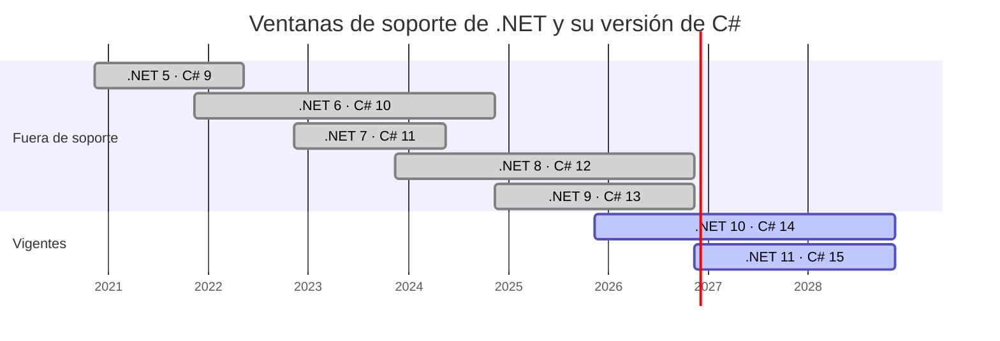
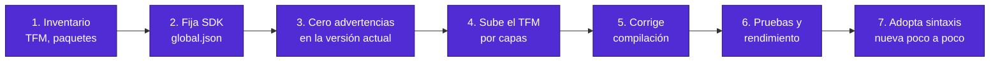

<div align="center">

# 18 · Migración y ciclo de vida

**Soporte de cada runtime, cambios incompatibles versión por versión y un método para actualizar sin sorpresas**

[⬅ 17 · Catálogo A–Z](17-catalogo-a-z.md) · [🏠 Índice](../README.md) · [19 · Referencia rápida ➡](19-referencia-rapida-y-glosario.md)

</div>

> [!IMPORTANT]
> Fecha de corte: **20 de noviembre de 2026**. **.NET 8 y .NET 9 no tienen soporte desde el 10 de noviembre de 2026**, el mismo día en que se publicó .NET 11 con C# 15.

---

## Contenido

1. [El lenguaje no caduca, el runtime sí](#1-el-lenguaje-no-caduca-el-runtime-sí)
2. [Ciclo de vida de .NET](#2-ciclo-de-vida-de-net)
3. [Método de migración](#3-método-de-migración)
4. [Cambios incompatibles por versión](#4-cambios-incompatibles-por-versión)
5. [Palabras contextuales que rompen nombres](#5-palabras-contextuales-que-rompen-nombres)
6. [Referencias](#6-referencias)

---

## 1. El lenguaje no caduca, el runtime sí

Una versión de C# no tiene fecha de fin: el compilador sigue aceptando `-langversion:7.3`. Lo que caduca es el **runtime**, y con él los parches de seguridad. Por eso migrar
de C# 12 a C# 14 es, en la práctica, migrar de .NET 8 a .NET 10.

| Política | Duración | Versiones |
|---|---|---|
| **LTS** | 3 años | Pares: .NET 8, 10 |
| **STS** | 2 años | Impares: .NET 9, 11 |
| Parches | Hay que instalar el último para seguir con soporte | Publicados normalmente el segundo martes de cada mes |

---

## 2. Ciclo de vida de .NET

| .NET | C# | Tipo | Lanzamiento | Último parche | Fin de soporte | Estado |
|---|---|---|---|---|---|---|
| **.NET 11** | 15 | STS | 10-nov-2026 | 11.0.0 | **14-nov-2028** | 🟢 Vigente |
| **.NET 10** | 14 | LTS | 11-nov-2025 | 10.0.15 | **14-nov-2028** | 🟢 Recomendado |
| .NET 9 | 13 | STS | 12-nov-2024 | 9.0.23 | 10-nov-2026 | ⛔ |
| .NET 8 | 12 | LTS | 14-nov-2023 | 8.0.34 | 10-nov-2026 | ⛔ |
| .NET 7 | 11 | STS | 8-nov-2022 | 7.0.20 | 14-may-2024 | ⛔ |
| .NET 6 | 10 | LTS | 8-nov-2021 | 6.0.36 | 12-nov-2024 | ⛔ |
| .NET 5 | 9 | STS | 10-nov-2020 | 5.0.17 | 10-may-2022 | ⛔ |
| .NET Core 3.1 | 8 | LTS | 3-dic-2019 | 3.1.32 | 13-dic-2022 | ⛔ |



Las fechas salen de la política de soporte oficial. **.NET Framework** sigue otra política, ligada a Windows, y se queda en C# 7.3 por defecto.

---

## 3. Método de migración



| Paso | Detalle |
|---|---|
| Actualiza primero las hojas | Las bibliotecas sin dependencias internas |
| Separa el cambio de TFM y el de estilo | Un PR para migrar, otros para modernizar: facilita la revisión y el `git bisect` |
| Revisa los *cambios de comportamiento* | Son más peligrosos que los errores de compilación: el código compila y hace otra cosa |
| Usa correcciones automáticas | `dotnet format`, analizadores `IDE*` y `CA*` |
| Prueba con `TreatWarningsAsErrors` | Las nuevas olas de advertencias aparecen con `AnalysisLevel` |

```bash
dotnet --list-sdks                    # SDK instalados
dotnet list package --outdated        # paquetes por actualizar
dotnet list package --vulnerable      # vulnerabilidades conocidas
dotnet format --verify-no-changes     # estilo, en integración continua
```

---

## 4. Cambios incompatibles por versión

**F** = cambia el código **fuente** (error o advertencia nueva) · **C** = cambia el **comportamiento** sin error ⚠️

### C# 15

Lista provisional: procede de la documentación de Roslyn para .NET 11.

| Tipo | Cambio | Solución |
|---|---|---|
| F | `closed` y `union` contextuales | `@closed`, `@union` |
| F | `with(...)` en una expresión de colección son argumentos | `@with(...)` |
| F | Una colección `Span` tiene contexto seguro *declaration-block* | Usa un arreglo o amplía el ámbito |
| F | `ref readonly` en delegados sintetizados y funciones locales necesita `InAttribute` | Añade la referencia |
| F | `&&` y `\|\|` dinámicos con interfaz a la izquierda | Tipo concreto o `dynamic` |
| F | `nameof(this.P)` en atributos (desde el SDK 10.0.200) | `nameof(P)` |
| C | `(X.Y) when` en un brazo de `switch` se analiza como patrón | Revisar |

### C# 14

| Tipo | Cambio | Solución |
|---|---|---|
| F | Ambigüedad por sobrecargas de `Span` | `.AsSpan()` o `OverloadResolutionPriority` |
| **C** ⚠️ | Se elige `Span<T>` y un arreglo covariante lanza `ArrayTypeMismatchException` | `.AsEnumerable()` o una sobrecarga `ReadOnlySpan<T>` |
| **C** ⚠️ | `x.Reverse()` en arreglo con TFM anterior a `net10.0` invierte en el sitio | Configuración sin soporte: usa `Enumerable.Reverse(x)` |
| F | `field` es palabra clave en accesores (CS9258, CS9272) | `@field`, `this.field` |
| F | `extension` contextual, y no vale como nombre de tipo | `@extension` |
| F | `partial` no puede ser tipo de retorno | `@partial` |
| F | `scoped` siempre es modificador en una lambda | `@scoped` |
| **C** ⚠️ | `MoveNext` tras `Dispose` devuelve `false` sin ejecutar código | Corrección de un error |
| F | Advertencia por patrón redundante en `is not null or 42` | Paréntesis: `not (null or 42)` |
| **C** ⚠️ | Miembros parciales de interfaz son `virtual` y `public` | `private` o `sealed` |
| F | `record` con punteros prohibido incluso con `Equals` propio (CS8908) | Elimina el campo puntero |
| F | Se reporta `Obsolete` en `DisposeAsync` por patrón | Actualiza la llamada |

### C# 13

| Tipo | Cambio | Solución |
|---|---|---|
| F | `[InlineArray]` no admitido en `record struct` (CS9259) | Usa `struct` |
| F | Iteradores introducen un contexto seguro | `unsafe` en la función local |
| **C** ⚠️ | Expresiones de colección: se prefiere el tipo exacto de elemento | Revisar sobrecargas |
| F | `[]` ya no desempata con `Span` | Tipo explícito |
| F | Grupos de métodos con `params` y valores por defecto: ambigüedad | Tipo de delegado explícito |

### C# 12

| Tipo | Cambio | Solución |
|---|---|---|
| **C** ⚠️ | Un `ref` puede pasarse a un parámetro `in`, y cambia la sobrecarga | Llamada estática explícita |
| **C** ⚠️ | `await using` prefiere el `DisposeAsync` por patrón | Revisar implementaciones explícitas |
| F | `ref` dinámicos comprobados al compilar (CS1620) | Añade `ref` |
| F | Destino de colección requiere constructor y `Add` | Añade `CollectionBuilder` o los miembros |

### C# 11

| Tipo | Cambio | Solución |
|---|---|---|
| F | Tipos `required`, `scoped`, `file` | `@` |
| F | `ref struct` puede capturar `ref` en métodos de instancia (CS8350) | `scoped ref` |
| F | Escape de `ref struct` con argumentos `ref` e `in` (CS8347) | `scoped` |
| F | No se devuelve `out` por referencia (CS8166) | `[UnscopedRef]` |
| **C** ⚠️ | `checked` sobre `IntPtr` puede desbordar | Contexto `unchecked` |
| **C** ⚠️ | `_ = local` en un `ref` local desreferencia | Revisar |
| F | `Length` y `Count` se asumen no negativos | Borra el brazo imposible |
| F | Raw string: la interpolación respeta la sangría | Alinea |

### C# 10

| Tipo | Cambio | Solución |
|---|---|---|
| F | `struct` con inicializador requiere constructor (CS8983) | Añádelo |
| **C** ⚠️ | Llaves en especificadores: `{{{12:X}}}` da `{C}` | Quita las llaves extra |
| F | `var` no vale como retorno explícito de lambda | `@var` |

### C# 9 y anteriores

| Versión | Tipo | Cambio |
|---|---|---|
| C# 9 | F | Tipos llamados `record` generan advertencia |
| C# 8 | — | Contexto anulable es opcional; requiere runtime para interfaces por defecto |
| C# 7.0 | C | Con patrones, el orden de `case` importa |
| C# 6 | C | Roslyn corrigió desviaciones del compilador nativo |
| C# 5 | **C** ⚠️ | Variable de `foreach` por iteración |
| C# 4 | C | Valores por defecto copiados en el llamador: hay que recompilar |

---

## 5. Palabras contextuales que rompen nombres

C# evita nuevas palabras **reservadas**: usa palabras **contextuales** que solo significan algo en cierta posición. Los conflictos son raros, pero `@` siempre los resuelve.

| Versión | Palabra |
|---|---|
| C# 3 | `var`, `from`, `select`, `where`, `group`, `into`, `orderby`, `join`, `let`, `on`, `equals`, `by`, `ascending`, `descending` |
| C# 5 | `async`, `await` |
| C# 6 | `nameof`, `when` |
| C# 8 | `notnull`, `unmanaged` (en restricciones) |
| C# 9 | `record`, `init`, `and`, `or`, `not`, `with`, `nint`, `nuint` |
| C# 11 | `required`, `scoped`, `file` |
| C# 13 | `allows` |
| C# 14 | `field`, `extension` |
| C# 15 | `union`, `closed`; `with` en colecciones |

> [!TIP]
> La advertencia CS8981, de la ola 7, avisa de nombres de tipo totalmente en minúsculas ASCII, porque son los candidatos a futuras palabras clave.

---

## 6. Referencias

- [.NET support policy](https://dotnet.microsoft.com/platform/support/policy/dotnet-core) · [C# compiler breaking changes](https://learn.microsoft.com/dotnet/csharp/whats-new/breaking-changes/)
- Listas de Roslyn: [.NET 7](https://learn.microsoft.com/dotnet/csharp/whats-new/breaking-changes/compiler%20breaking%20changes%20-%20dotnet%207) · [.NET 8](https://learn.microsoft.com/dotnet/csharp/whats-new/breaking-changes/compiler%20breaking%20changes%20-%20dotnet%208) · [.NET 9](https://learn.microsoft.com/dotnet/csharp/whats-new/breaking-changes/compiler%20breaking%20changes%20-%20dotnet%209) · [.NET 10](https://learn.microsoft.com/dotnet/csharp/whats-new/breaking-changes/compiler%20breaking%20changes%20-%20dotnet%2010) · [.NET 11](https://learn.microsoft.com/dotnet/csharp/whats-new/breaking-changes/compiler%20breaking%20changes%20-%20dotnet%2011)
